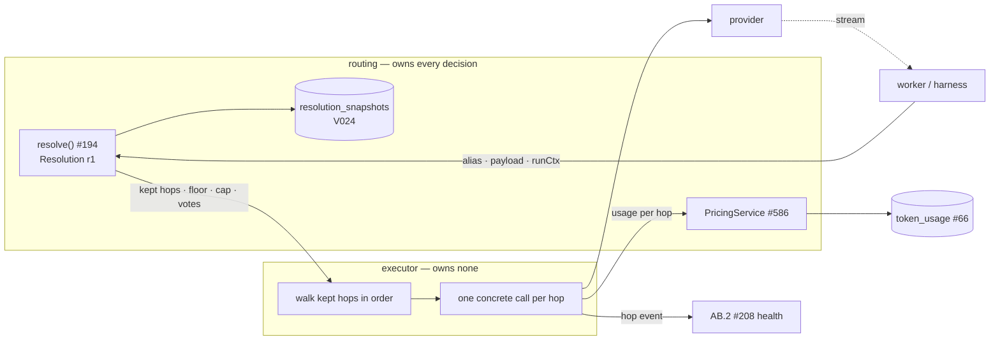

# Invocation gateway — requirements from routing

**What this is:** routing's requirements for whatever executes a resolved chain against real
providers. This document is the input to the invocation gateway ADR, AF.1
([#234](https://github.com/NobuData/ouroboros/issues/234)). AF.2
([#235](https://github.com/NobuData/ouroboros/issues/235)) implements what that ADR decides.
The source is issue AB.1 ([#207](https://github.com/NobuData/ouroboros/issues/207)),
including its Live Loop amendment.

**What this is not:** a decision. Decision **M9**
([`ROADMAP_MOCKUP_06_MODEL_ROUTING.md`](ROADMAP_MOCKUP_06_MODEL_ROUTING.md)) leaves the choice
between a custom executor over the adapter SPI (option 4-A) and a self-hosted LiteLLM under
our resolution (option 4-B) to the ADR. This document says what either one has to do, what it
must not own, and what each candidate looks like against that. The ADR picks — and has:
[`DECISION_INVOCATION_GATEWAY.md`](DECISION_INVOCATION_GATEWAY.md) adopts 4-A and closes G3,
G6 and G8.

**Read with:**

- [`ouroboros-rest/src/modules/routing/resolution.ts`](../ouroboros-rest/src/modules/routing/resolution.ts) — the `Resolution` shape an executor receives (Z.1, [#194](https://github.com/NobuData/ouroboros/issues/194)).
- [`ouroboros-rest/src/modules/internal/invoke.contract.ts`](../ouroboros-rest/src/modules/internal/invoke.contract.ts) — `POST /internal/llm/invoke`, the request and event shapes (AD.3, [#224](https://github.com/NobuData/ouroboros/issues/224)).
- [`MODEL_PROVIDERS.md`](MODEL_PROVIDERS.md) — the adapter SPI and its five-class error taxonomy.
- [`SECURITY_MODEL.md` § 4](SECURITY_MODEL.md#4-what-a-worker-is-given) — what a worker is given, and proxied invocation.
- [`ROADMAP_OOE_LIVE_LOOP.md`](ROADMAP_OOE_LIVE_LOOP.md) — decisions L3, L4 and L6, and issue DH.2.

Every statement about shipped code below was checked against the files named, as of
2026-10-14.

## The boundary in one picture

**Routing decides. The executor carries out the decision.** Each requirement below follows
from that sentence.

## What the executor must do

Each requirement gives a rule, the reason for it, and where the contract already names it.
Where the contract does not name it yet, the gap is listed in
[Gaps this document found](#gaps-this-document-found).

### R1 — Execute the chain exactly as resolved

- Walk `resolution.chain.filter((hop) => hop.decision === "kept")`, **in array order**, one
  concrete call per hop: that hop's `provider` and `modelId`, with its `params` merged over the
  caller's payload as the adapter defines.
- **Never re-decide.** No reordering, no load balancing across hops, no model-group or alias
  lookup of the executor's own, no hop that is not in the chain, and no skipping of a kept hop
  because of the executor's own view of health. Routing has already applied health (Z.3), rules
  and the floor. A `dropped` hop stays dropped, and its explanation is routing's to give.
- **Never execute a `fail_run` resolution.** `outcome: "fail_run"` means the run may not
  proceed. The executor returns the resolution's `failure.code` and runs nothing.
- Retrying is allowed **within one hop only**, on the same provider and model, and bounded the
  way [`MODEL_PROVIDERS.md` § Retrying](MODEL_PROVIDERS.md#retrying-and-how-to-bound-it)
  bounds it (attempts *and* a time budget). Retrying is never an excuse to move to a model
  routing did not choose.
- A worker that names a `connection` instead of an `alias` gets that provider and no other:
  no chain, no fallback, no floor. A failure is a failure, not a hop
  (`invoke.contract.ts`, decision 1).

### R2 — A per-hop error taxonomy that matches what routing promised

The inspector tells a user what each hop catches. If the executor disagrees, the UI is wrong.
The adapter SPI classifies every failure into exactly five classes, and the invoke contract
names the rule for each one. Together they make one table:

| Adapter class (`MODEL_PROVIDERS.md`) | Typical cause | Invoke code (`invoke.contract.ts`) | Executor behaviour |
|---|---|---|---|
| `upstream` | any `5xx` | `provider_unavailable` | **Advance** to the next kept hop |
| `network` | refused socket, DNS, timeout, `408` | `provider_unavailable` | **Advance** |
| `rate_limit` | `429` | `provider_rate_limited` | Bounded back-off on the same hop, then **advance** |
| `auth` | `401`, `403`, `407` | `provider_auth_failed` | **No retry.** The connection is reported in error |
| `config` | `3xx`, every other `4xx` | `request_invalid` | **Abort.** The next hop would refuse the same payload |
| — | kept hops exhausted, floor set | `floor_exhausted` | **Abort** with the floor reason (R3) |
| — | kept hops exhausted, no floor | `chain_exhausted` | **Abort** |
| — | the run's cap reached | `cost_cap_exceeded` | **Abort**, naming the cap and its source (R4) |

- **The mapping lives in the contract, not in the executor.** A candidate that brings its
  own exception hierarchy must translate it into these codes at its edge. It must not grow a
  parallel set.
- Errors are **per hop**, so a hop event (R8) is emitted for every attempted hop, including
  the ones that failed over.
- A provider's own error text never reaches the person reading the run (`error.envelope.ts`).
  The `message` on an `error` event is ours.
- **`provider_auth_failed` on hop *n*:** the table says no retry, but whether the chain then
  advances or aborts is **not stated anywhere today**. See gap G3.

### R3 — Floor abort: never degrade past the floor

The floor is enforced in two places, and the executor has the smaller part:

1. **Resolution already drops every hop below the floor** (`below_floor` in
   `routing/explanations.ts`). If no hop survives, it answers `fail_run` with `floor_breached`
   and the executor runs nothing (R1).
2. **The executor's part:** when every kept hop has failed over **and**
   `resolution.floor.hopIndex` is not null, the run fails with `floor_exhausted` rather than
   `chain_exhausted`. That is the whole difference between the two codes. The person reading
   the run learns that the floor stopped it, rather than that everything simply broke.

- **Degrading past the floor is not a behaviour any configuration can enable.** No setting,
  header or retry policy reaches a model below it.
- The floor is measured against a hop's **stored position** (`route_hops.position`), never its
  index in the resolved chain. A rule that prepends a hop must not move a floor the operator
  set (`resolution.ts`, `ResolutionHop.position`). See gap G4.

### R4 — Per-run cost cap, with usage captured per hop

- **The cap is routing's, not the executor's.** It is `resolution.maxCostCents`: the stricter
  of the route's cap and the org policy's `spend_guard`, with `resolution.costCap` naming which
  one set it (BQ.2, #481). A tighter cap sent by the worker in `runCtx.costCapCents` may only
  lower it, never raise it (`RunContext`).
- **Checked before the call and while it streams.** A single streaming response can cross a
  cap it was under when it started. On a breach the stream stops and the run fails with
  `cost_cap_exceeded`, naming the source.
- **Usage is emitted per hop**, including a hop that failed partway, and attributed to the
  connection and model that actually served it (`InvokeUsageEvent`). It becomes a
  `token_usage` row (V010, #66). The spend card, routing's `$/run` (Z.5) and the caps all read
  that table.
- **Cost comes from the pricing service, not from the executor.** `costCents` is resolved
  through `PricingService.resolve` (CH.3, [#586](https://github.com/NobuData/ouroboros/issues/586)).
  It is `null` when nothing prices the model — *unpriced*, never `0`. An executor with a price
  table of its own (option 4-B ships one) must not be the source of a stored cost.
- **Unpriced spend under a cap** has no rule today. See gap G6.

### R5 — Vote execution — and its deferral

- A vote is **a real invocation with its own usage.** `resolution.votes` lists second
  opinions an `add_vote` rule attached. Each is executed against its own `provider` and
  `modelId` with `runCtx.vote: true`, so its usage row is attributed to the vote and does not
  inflate the primary call. A vote is **not a hop**. It is never where the run falls back to.
- **Deferral (DG.1 amendment): vote execution may be deferred past the Live Loop slice.** The
  slice's workflow has no vote rule, and second-model review, AZ.1
  ([#371](https://github.com/NobuData/ouroboros/issues/371)), is the recommended first
  promotion after the slice's gate. It brings vote execution with it. AF.2 can therefore ship
  for the slice without votes.
- **Deferred must never mean silently dropped.** While votes are unimplemented, an
  invocation whose resolution carries a non-empty `votes` list is **refused with a named
  reason**. It is not executed without its vote, because that would turn the operator's rule
  into a no-op that nobody can see. The contract has no code for this yet. See gap G5.

### R6 — Streaming, always

- The answer to `POST /internal/llm/invoke` is **always** an NDJSON event stream
  (`delta`, `usage`, `hop`, `error`, `done`), whether the provider streamed or not
  (`invoke.contract.ts`, decision 3).
- Deltas are relayed **as they arrive**, not buffered to the end of the response.
- Usage must be captured on **streamed** responses. A design that only knows token counts for
  non-streamed calls fails R4.

### R7 — Local providers are first-class

Ollama and vLLM (via the `openai-compatible` adapter) get the same treatment as hosted
providers: the same error taxonomy, the same streaming events, the same hop telemetry, and
usage rows with `costCents: null` (unpriced, R4). Never a degraded path, and never one that
skips usage because the call was free. The route's **Allow fallback to local models** switch
(`resolution.allowLocalFallback`) is applied by routing before the executor sees the chain.

### R8 — Per-hop telemetry in the shape AB.2 aggregates

AB.2 ([#208](https://github.com/NobuData/ouroboros/issues/208)) turns executor traffic into
provider health. It asks for **success, error class, latency, provider and alias** per hop,
aggregated per provider connection into error rate, p50 and p95 over a rolling window, and
written into `provider_connections.health` with minimum-sample gates and hysteresis.

What `InvokeHopEvent` carries today, against that list:

| AB.2 needs | `InvokeHopEvent` | Status |
|---|---|---|
| Success | `outcome: ok \| failed_over \| aborted` | ✓ |
| Error class | `code` (an invoke code, R2) | ✓ — one code per failure, derivable to the adapter's class |
| Latency | `latencyMs` | ✓ |
| Provider | `connection` (`provider_connections.id`) | ✓ — the key AB.2 aggregates by |
| Alias | — | **missing** (gap G7) |
| When (window membership) | — | **missing**. Stamped by the executor at emission, not by the worker (gap G7) |

**Verdict:** compatible with AB.2's aggregation once the two missing fields are added. They
are additions, not changes, so the event's existing fields do not move. Every *attempted*
hop emits one event, so a chain that failed over twice yields three events, and AB.2's
sample counts include failovers. A vote's invocation emits hop telemetry like any other call:
its provider's health is real traffic too.

### R9 — Reachable in Anthropic Messages format by a stage harness (DG.1 amendment)

Live Loop decisions L3 and L6 run the slice's tool-using stage through an agent harness (the
Claude Agent SDK) that makes its own model calls. The harness speaks the Anthropic Messages
API, not our invoke contract. So the executor must also be reachable as:

- **`POST /v1/messages` in Anthropic Messages format**, behind the facade DH.2 specifies
  (`/internal/harness/anthropic/v1/messages`, internal network only), streaming server-sent
  events **unbuffered**, including `ping` events.
- **With per-call usage capture**: one usage row per harness call, attributed to run, stage,
  attempt, provider and model, through the same path as R4, and checked against the cap
  before each call.
- **On a run-scoped credential only.** The harness holds a short-lived credential bound to one
  run, stage and routing alias (AD.3's lease, [#224](https://github.com/NobuData/ouroboros/issues/224)).
  The provider key never enters the engine (R10).
- **Model = routing alias.** The facade resolves it through #194, like any other call.
  Non-Anthropic-format hops are **skipped with an explanation** in the resolution, never
  silently. A chain with no Anthropic-format hop fails with a reason that says so.
- `anthropic-version` and `anthropic-beta` are forwarded unchanged, request fields are an open
  list, and upstream error bodies are returned unmodified, as the vendor's
  [gateway guide](https://code.claude.com/docs/en/llm-gateway-protocol) requires of a gateway.

This is a second *surface* over the same executor, not a second executor. R1–R8 apply to it
unchanged.

### R10 — Keys never leave the control plane

Decision **P3**, [`SECURITY_MODEL.md` § 4.2](SECURITY_MODEL.md#42-proxied-invocation): a
worker never holds a provider credential. The executor unwraps a key inside one request
scope, for one hop, and nothing it returns, logs or emits contains it. A candidate that needs
keys in its own configuration file or environment has to show where they live and who can
read them.

## What the executor must not own

These are **non-goals**. A candidate that brings one of them must have it switched off, not
merely left unused by convention:

- **Aliases.** `model_aliases` is the only alias table. No executor-side model group, alias
  map or name rewriting.
- **Routes and fallback order.** The chain is given (R1). No executor-side fallbacks, retries
  that change model, or load balancing.
- **Escalation rules.** Applied before the chain exists.
- **Floors.** Applied by resolution. The executor only names one when it stops at it (R3).
- **Cost policy and pricing.** The cap comes from the resolution and prices from
  `PricingService` (R4). No executor-side budgets, spend limits or price tables as a source of
  stored cost.
- **Provider health.** Health comes from Z.3 and, later, AB.2. No executor-side cooldowns or
  circuit breakers that take a provider out of service on their own. The executor *reports*
  hop outcomes (R8); routing *acts* on them.

## Is `resolution_version` sufficient for both candidates?

AB.1's third acceptance criterion asks for this to be verified against each candidate, not
assumed. It is two questions, because the word "version" is doing two jobs.

**1. As a shape pin — yes, for both.** `RESOLUTION_VERSION` is the constant `"r1"`
(`resolution.ts`). It promises that the *fields* of `Resolution` keep their names and meanings.
Adding a hop code is not a bump; a rename or a change in meaning is.

- **4-A, custom executor:** consumes `Resolution` in-process and can pin `ResolutionVersion`
  as a type. `r1` gives it everything it walks: kept hops with `provider` and `modelId`, the
  floor, the cap and its source, and votes. Sufficient.
- **4-B, LiteLLM under custom:** our code walks the resolution and hands LiteLLM **one
  concrete model per call**. LiteLLM never reads a `Resolution`, so the shape pin is ours to
  hold, exactly as in 4-A. Sufficient, *on the condition* that LiteLLM is never given the chain
  as its own fallback list (that is the non-goal above).

**2. As the identity of a particular resolution — no, for either.** `RunContext.resolutionVersion`'s
comment in `invoke.contract.ts` says it lets a call planned under one resolution, and executed
after a rebind, be recognised. A constant cannot do that: every resolution is `"r1"`. What
identifies a particular resolution is the **`resolution_snapshots` row** (V024) recorded for
the run. That is the identity a call has to carry, alongside the shape version. This holds for
both candidates, because neither has a way to detect a rebind from `"r1"`. See gap G1.

## The candidates against these requirements

> Evaluation notes, not the decision. The ADR (#234) owns the decision, the measured streaming
> prototype and the graduation triggers.

**Excluded up front — option 4-C, a hosted gateway (OpenRouter, Portkey):** keys and traffic
leave the deployment. That breaks the self-hosting constraint and the providers page's privacy
promise ([`ROADMAP_MOCKUP_07_PROVIDERS_KEYS.md`](ROADMAP_MOCKUP_07_PROVIDERS_KEYS.md),
infrastructure option C). At most it could be an optional *adapter*, never the primary path.

**4-A — a custom executor over the adapter SPI.** It meets each requirement by construction
or not at all. There is no foreign behaviour to switch off, and every requirement is code that
#235 writes and tests. Its cost is the work itself: a streaming implementation per adapter, and
the Messages-format surface (R9) as a facade of our own (DH.2).

**4-B — self-hosted LiteLLM underneath our resolution.** LiteLLM is a Python SDK and a proxy
server, MIT-licensed outside its `enterprise/` directory (PyPI `litellm` 1.105.1, read
2026-10-14). `ouroboros-rest` is TypeScript, so 4-B means the **proxy** as a sidecar, or the SDK
inside a Python service that REST calls. Either way, R10 decides where the unwrapped key travels.

| Requirement | 4-A custom | 4-B LiteLLM under custom — what has to be true |
|---|---|---|
| R1 chain as given | Native | REST walks the chain and sends **one concrete model per call**. LiteLLM's own routing has to be off: its retry default falls back to the OpenAI client's (`num_retries` unset → `openai.DEFAULT_MAX_RETRIES`), cooldowns are on (`allowed_fails` 3, 5 s), and the default strategy is `simple-shuffle`. These are disabled with `num_retries=0` and `disable_cooldowns=True`, and by configuring no `fallbacks`. Fallbacks can also be refused per request with `disable_fallbacks`. The **proxy** reaches an unlisted `provider/model` only through a wildcard entry (`model_name: "*"`), which still runs through its router. The SDK takes a concrete model directly |
| R2 taxonomy | Native — the adapter's five classes | LiteLLM maps errors to typed exceptions (`RateLimitError`, `AuthenticationError`, `Timeout`, `ServiceUnavailableError`, `ContextWindowExceededError`, `NotFoundError`, …). For providers other than OpenAI and Azure, most classes **set a fixed `status_code`**, so the raw upstream status is not always preserved, and an unmapped error becomes `APIConnectionError` with `500`. That would read as `provider_unavailable` (advance) when it might deserve an abort. Translation to our codes has to be by exception class, tested per adapter |
| R3 floor | Native | Unaffected, *provided* LiteLLM never holds the chain. Its own fallbacks would be a second, floor-unaware way to reach a model |
| R4 cap and usage | Native | Usage on streamed calls is **opt-in**: `stream_options.include_usage`, or the proxy's `always_include_stream_usage: true`. LiteLLM computes `response_cost` from the community `model_prices_and_context_window.json`, which is **fetched from `api.litellm.ai` by default**. That is a second price source and an outbound call. It must be ignored for stored cost (R4: cost comes from `PricingService`), and the fetch disabled (`LITELLM_LOCAL_MODEL_COST_MAP=True`). Its budgets are opt-in and need its own database, so they can stay unused |
| R5 votes | Native | A vote is one more single-model call; no LiteLLM feature is involved |
| R6 streaming | Per adapter | Streaming across providers is LiteLLM's main offer. The overhead under load is what the ADR's prototype has to measure |
| R7 local parity | Existing `ollama` and `openai-compatible` adapters | Ollama is native (`ollama_chat/` → `/api/chat`). **Tool calls fall back to JSON-mode emulation** where a model lacks native tool calling. vLLM is OpenAI-compatible (`hosted_vllm/`). Streamed usage for either is not documented, so it has to be tested, not assumed |
| R8 telemetry | Native | `CustomLogger` success and failure hooks carry status, timing including time to first token (`completionStartTime`), model, tokens and `error_information`. They are enough to *derive* our hop event, but not to replace it. Hop numbering and the `connection` id are ours |
| R9 Messages surface | DH.2's facade, ours to write | The proxy exposes Anthropic `/v1/messages` with streaming, and usage including cache-token fields. The vendor's gateway pages do not mention LiteLLM, and say Claude Code is not supported against non-Claude models through any gateway, which is consistent with R9 skipping non-Anthropic hops. Pass-through of `ping` events, unmodified error bodies and `anthropic-beta` has to be **verified**, not assumed |
| R10 keys | Unwrapped per request inside REST | The SDK takes a key per call. The proxy's documented model is keys in its config or environment, with Postgres for virtual keys. Per-request key injection through the proxy, without a key at rest in the sidecar, has to be shown |
| Non-goals | Nothing to switch off | Model groups, `model_group_alias`, fallbacks, cooldowns, budgets and the cost map all exist and all have to be **off**. The alias-fallback bug ([litellm#15493](https://github.com/BerriAI/litellm/issues/15493): a fallback not triggered when the request used a `model_group_alias`) was closed as *not planned* by the stale bot on 2026-01-20 with no fix. That is the divergence class M9 warned about, and it only bites if LiteLLM's aliases are used, which this document forbids |

**What the table says, without deciding:** 4-B can satisfy every requirement, but only as a
configured subset of LiteLLM. Nearly every row depends on a default being turned off, so
the ADR should treat *"the configuration that disables LiteLLM's routing"* as a tested artefact
of its own, not as a setup note. 4-A has no such surface and pays for it in streaming work per
adapter.

## Gaps this document found

Each gap is something the contract or the schema does not yet say, found while checking the
requirements above against shipped code. None is decided here. Each is input to #234 or work
for #235.

| # | Gap | Where | Who closes it |
|---|---|---|---|
| G1 | `RunContext.resolutionVersion` is documented as detecting a rebind, but `RESOLUTION_VERSION` is the constant `"r1"`. A call needs the `resolution_snapshots` id to be recognisable against a particular resolution | `invoke.contract.ts`, `resolution.ts`, V024 | #235 |
| G2 | `token_usage` has `run_id`, `provider`, `model`, tokens, `cost_cents`, `task_kind` and `latency_ms`, but no hop, connection, stage, attempt or vote marker, and no cache-token counts. R4, R5 and R9 attribute to all of these | V010 and later migrations | #235 with #91 |
| G3 | `provider_auth_failed` says *no retry* but not whether the chain advances to the next hop or aborts | `invoke.contract.ts` | #234 — **advances** ([decision](DECISION_INVOCATION_GATEWAY.md#the-three-gaps-this-adr-closes)) |
| G4 | `RunContext.floorHopIndex` is called a *hop index*, but the floor is measured against stored `position`, not chain `index`. The name invites the wrong comparison | `invoke.contract.ts` vs `resolution.ts` | #235 |
| G5 | There is no error code for *vote execution unavailable* (R5's refusal while votes are deferred) | `INVOKE_ERROR_CODES` | #235 |
| G6 | A cap cannot be checked against unpriced spend (`costCents: null`). Whether unpriced usage counts against a cap, is refused under one, or passes, is not stated | `invoke.contract.ts`, #586 | #234 — **passes, not counted** ([decision](DECISION_INVOCATION_GATEWAY.md#the-three-gaps-this-adr-closes)) |
| G7 | `InvokeHopEvent` has no `alias` and no timestamp; AB.2 needs both (R8) | `invoke.contract.ts` | #235 |
| G8 | Some refusals in the `config` class are model-specific (context window exceeded, model not found), so a later hop might succeed. R2 aborts on all of them today | `MODEL_PROVIDERS.md`, `invoke.contract.ts` | #234 — **these two advance** ([decision](DECISION_INVOCATION_GATEWAY.md#the-three-gaps-this-adr-closes)) |

## Acceptance — how to tell an executor meets this

An executor, whichever candidate, meets this document when its tests show:

1. A two-hop chain whose primary answers `503` serves from hop 2, with two hop events and usage
   attributed to hop 2's connection and model.
2. A `400` on the primary aborts with `request_invalid`. Hop 2 is never called.
3. A chain exhausted with a floor set fails `floor_exhausted`; without one, `chain_exhausted`.
4. A `fail_run` resolution runs nothing and returns its `failure.code`.
5. A cap crossed mid-stream stops the stream with `cost_cap_exceeded` and names the source.
6. An unpriced model's usage is stored with a null cost, never `0`.
7. A resolution with a vote is either executed with the vote's own usage row or, while votes
   are deferred, refused with a named reason. It is never run without the vote and without a
   word.
8. An Ollama hop streams, emits usage and emits hop telemetry exactly like a hosted one.
9. No configuration of the executor can reorder the chain, add a hop or cross the floor.
10. A harness session through the Messages-format surface yields one usage row per call
    (DH.2's own criteria apply in full).

## Sources

- Issue AB.1 [#207](https://github.com/NobuData/ouroboros/issues/207) and its DG.1 amendment
  (#1299); AF.1 [#234](https://github.com/NobuData/ouroboros/issues/234); AF.2
  [#235](https://github.com/NobuData/ouroboros/issues/235); AB.2
  [#208](https://github.com/NobuData/ouroboros/issues/208); Z.1
  [#194](https://github.com/NobuData/ouroboros/issues/194); CH.3
  [#586](https://github.com/NobuData/ouroboros/issues/586).
- Code read 2026-10-14: `ouroboros-rest/src/modules/routing/resolution.ts`,
  `routing/explanations.ts`, `internal/invoke.contract.ts`, `db/schema.ts`
  (`token_usage`, `resolution_snapshots`); `ouroboros-db/migrations/V010__dashboard_usage.sql`,
  `V024__resolution_snapshots.sql`.
- [`ROADMAP_OOE_LIVE_LOOP.md`](ROADMAP_OOE_LIVE_LOOP.md) § Issue DH.2, decisions L3, L4, L6.
- LiteLLM, read first-hand 2026-10-14 (code facts from the `main` branch, not a pinned
  release): [Anthropic unified endpoint](https://docs.litellm.ai/docs/anthropic_unified) ·
  [routing](https://docs.litellm.ai/docs/routing) ·
  [reliability](https://docs.litellm.ai/docs/proxy/reliability) ·
  [proxy configs](https://docs.litellm.ai/docs/proxy/configs) ·
  [exception mapping](https://docs.litellm.ai/docs/exception_mapping) ·
  [usage](https://docs.litellm.ai/docs/completion/usage) ·
  [token usage and cost](https://docs.litellm.ai/docs/completion/token_usage) ·
  [Ollama](https://docs.litellm.ai/docs/providers/ollama) ·
  [vLLM](https://docs.litellm.ai/docs/providers/vllm) ·
  [custom callbacks](https://docs.litellm.ai/docs/observability/custom_callback) ·
  [logging spec](https://docs.litellm.ai/docs/proxy/logging_spec) ·
  [deploy](https://docs.litellm.ai/docs/proxy/deploy) ·
  [budgets](https://docs.litellm.ai/docs/proxy/users) ·
  [`router.py`](https://github.com/BerriAI/litellm/blob/main/litellm/router.py) ·
  [`exceptions.py`](https://github.com/BerriAI/litellm/blob/main/litellm/exceptions.py) ·
  [LICENSE](https://github.com/BerriAI/litellm/blob/main/LICENSE) ·
  [issue #15493](https://github.com/BerriAI/litellm/issues/15493).
- Anthropic: [LLM gateways](https://code.claude.com/docs/en/llm-gateway) ·
  [gateway compatibility guide](https://code.claude.com/docs/en/llm-gateway-protocol).
- **Not verified here, stated where used:** the OpenAI client's retry default (2) that LiteLLM
  falls back to; streamed usage for Ollama and vLLM through LiteLLM; LiteLLM's `/v1/messages`
  against Ollama or vLLM backends; LiteLLM's behaviour for a model with no price entry;
  per-request key injection through the proxy.
