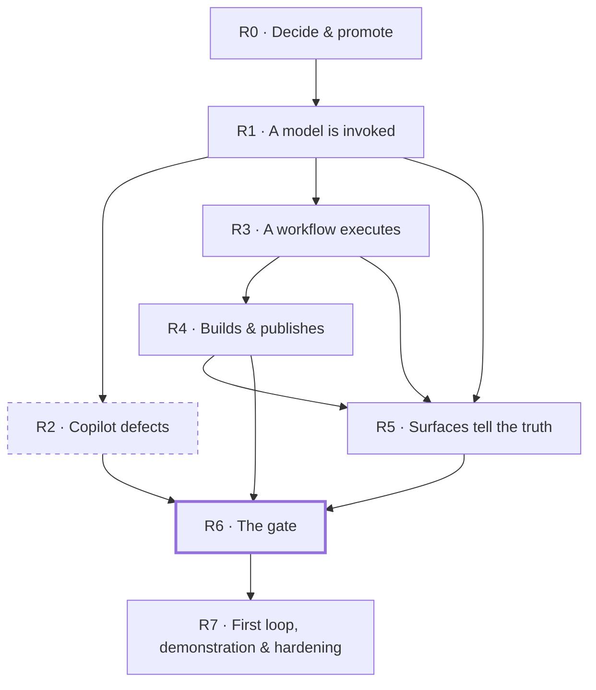

# Roadmap — Order of Execution (RC1)

## Description

> Create a new Order-of-Execution document that covers the first set of features for the
> next release, as Release Candidate 1 (RC1). Any issues set for RC1 are set on that
> milestone, and this document links each one to its ticket in GitHub.

This document does not introduce new scope. It is a **sequencing plan** over issues that
are already filed: which to build, in what order, and why that position and not another.
Each issue, and the roadmap it came from, remains the authority on *what* it contains; this
document is the authority on *when* it is built and on *which issues make up RC1*.

**RC1 is one thing: the first real run.** One GitHub issue goes in, a workflow version
executes, a model is invoked through the registry, a build runs on a real runner and a
draft pull request comes out — reproducibly, with every surface saying which of its numbers
are live. That is the Live Loop slice [`ROADMAP_OOE_LIVE_LOOP.md`](ROADMAP_OOE_LIVE_LOOP.md) specifies, and it is first because every other
open roadmap (runtime security, spend governance, the trust centre, editions, protocols,
proof of value, the marketplace) describes controls over, claims about or prices for a loop
that has not yet run once. RC1 also carries **every defect open on the day it was cut**, so
that the candidate does not ship a feature it has just switched on with known faults in it.

It succeeds [`ROADMAP_OOE_MVP.md`](ROADMAP_OOE_MVP.md), which ordered the control plane, and
it does not replace [`ROADMAP_OOE_LIVE_LOOP.md`](ROADMAP_OOE_LIVE_LOOP.md): that document specifies the slice — its decisions L1–L14, its
amendments to existing issues, its risks. This one fixes the slice's place in a release,
adds the defects, and is where progress toward RC1 is read.

**Status vocabulary, used strictly.** *Shipped* — the issue is closed on GitHub. *Open* —
filed and not closed. Nothing here describes open work as existing. On the day this
document was written, **no RC1 issue was closed**.

## Scope of the plan

| | |
|---|---|
| Milestone | [**RC1**](https://github.com/NobuData/ouroboros/milestone/61) — created 2026-10-13; every issue below is on it |
| **Ordered in this plan** | **44** issues |
| — new Live Loop issues (epics DG–DL) | 25 |
| — existing execution-chain issues, promoted and ordered | 11 |
| — open defects | 8 |
| Total complexity | **116 points** over the 36 sized issues (XS=1 · S=2 · M=3 · L=5); the 8 defects carry no chip and are not estimated here |
| Phases | **8** (R0–R7) |
| Critical path to the gate | **10 issues** — DG.1 → AB.1 → AF.1 → AF.2 → DH.2 → DH.3 → AR.1 → DI.2 → DI.3 → DI.6 |

**What RC1 is not.** Autonomous merge ([#375](https://github.com/NobuData/ouroboros/issues/375)), the second-model review gate ([#371](https://github.com/NobuData/ouroboros/issues/371)),
the provider-neutral tool loop, CLI harnesses, agent stages on runners, best-of-n,
coordinator runs and the reference benchmark ([#1309](https://github.com/NobuData/ouroboros/issues/1309), [#1306](https://github.com/NobuData/ouroboros/issues/1306), [#1305](https://github.com/NobuData/ouroboros/issues/1305), [#1323](https://github.com/NobuData/ouroboros/issues/1323), [#1324](https://github.com/NobuData/ouroboros/issues/1324), [#1329](https://github.com/NobuData/ouroboros/issues/1329)) stay on
`Live Loop v2`. No issue from the Agent Security, Spend Governance, Trust Centre, Editions,
Enterprise, Protocols & Surfaces, Proof of Value, Marketplace or Docs Site v2 milestones is
in RC1; they are candidates for the release candidates after it. The Studio mount issues
([#918](https://github.com/NobuData/ouroboros/issues/918), [#919](https://github.com/NobuData/ouroboros/issues/919), [#920](https://github.com/NobuData/ouroboros/issues/920), [#921](https://github.com/NobuData/ouroboros/issues/921), [#922](https://github.com/NobuData/ouroboros/issues/922)), [#968](https://github.com/NobuData/ouroboros/issues/968) and [#1100](https://github.com/NobuData/ouroboros/issues/1100) are open, carry no milestone, and are
**not** in RC1: none is a defect and none is on the path to a first run.

## Progress

**34 of 44 ordered issues are closed.** Every issue number in this document links to its
GitHub issue, and a **✅** in front of one means that issue is **closed**.

| Status | Phases | Issues |
|--------|--------|-------:|
| ✅ **Complete** | R0, R1, R2, R3, R4, R5 | **33** |
| 🟡 **In progress** | R7 | **1** of 10 |
| ⬜ **Not started** | R6 | **0** of 1 |

> The checkmarks are derived from GitHub issue state, not from this document. Re-derive
> them with `gh issue list --milestone RC1 --state closed --limit 100 --json number`
> whenever the plan is revisited; a ✅ here that GitHub disagrees with is stale, and GitHub
> wins.

## Version

RC1 is a **milestone, not a version string**. [`CONVENTIONS.md`](CONVENTIONS.md) § 8
versions each module independently in its own manifest and keeps no repository-wide
version, and this plan does not introduce one. What a person sees is the application's own:

- **In the application** — the last line of the account menu (the avatar, top right) reads
  **Ouroboros v…**. `ouroboros-ui/app/version.ts` imports `ouroboros-ui/package.json`, so
  the string is the manifest's and is written nowhere else.
- **On the documentation site** — the navbar ends with **RC1**: the release the pages
  describe, not a module version. It is `RELEASE` in `ouroboros-docs/site.constants.ts`
  and changes when the next release is cut.

Both shipped with this document (`ouroboros-ui` 0.163.0, `ouroboros-docs` 0.5.9). The
module versions on `main` when RC1 was cut:

| Module | Version | Where it is written |
|--------|---------|---------------------|
| `ouroboros-ui` — **the version the application shows** | 0.163.0 | `ouroboros-ui/package.json` |
| `ouroboros-rest` | 0.41.32 | `ouroboros-rest/package.json` (reported on `GET /api/v1`) |
| `ouroboros-engine` | 0.7.29 | `ouroboros-engine/pyproject.toml` |
| `ouroboros-runner` | 0.8.0 | `ouroboros-runner/VERSION` |
| `ouroboros-docs` | 0.5.9 | `ouroboros-docs/package.json` |

These move with every issue below, as § 8 requires; the table is a record of the starting
point, not something to keep current. Whether the release RC1 is a candidate *for* takes a
single product version is **not decided here** — see [Open decisions](#open-decisions).

## How the order was derived

1. **Selection.** The slice is the `Live Loop MVP` set as [`ROADMAP_OOE_LIVE_LOOP.md`](ROADMAP_OOE_LIVE_LOOP.md) § *Totals* counts it: 25
   new issues and 11 existing ones. To it were added the 8 issues labelled `bug` that were
   open on 2026-10-13. Nothing else was pulled in.
2. **Graph.** Dependencies are the *Parallelism/Dependencies* line of each new issue and the
   *Order* and *Amendment* columns of the promotion table in [`ROADMAP_OOE_LIVE_LOOP.md`](ROADMAP_OOE_LIVE_LOOP.md). Dependencies on closed
   issues are omitted from the tables below.
3. **Phases.** [`ROADMAP_OOE_LIVE_LOOP.md`](ROADMAP_OOE_LIVE_LOOP.md) § *Work Order* gives seven phases (0–6); they are kept, as R0–R1 and
   R3–R7. One issue moves: **DI.5** sits in R4 rather than with the gate, because DJ.4 (R5)
   needs its fixtures and the Work Order already allows it to be built then. R2 is new and
   holds the Workflow Copilot defects.
4. **Validation.** Every `Blocked by` entry in this document names an issue with a smaller
   `#` — **zero forward references**. Executed top to bottom, no issue starts before its
   prerequisites are finished.

Within a phase, issues are listed in dependency order; issues with no blocker in common can
be built in parallel.

## Sequencing principles applied

Inherited from [`ROADMAP_OOE_MVP.md`](ROADMAP_OOE_MVP.md); these are the ones that decided a
position the graph left open.

| # | Principle | Where it bites |
|---|-----------|----------------|
| **1** | **Decisions before the code that embodies them.** | Both ADRs ([#234](https://github.com/NobuData/ouroboros/issues/234), [#155](https://github.com/NobuData/ouroboros/issues/155)), the `StageExecutor` SPI ([#1302](https://github.com/NobuData/ouroboros/issues/1302)) and the provider-terms record ([#1304](https://github.com/NobuData/ouroboros/issues/1304)) are R0; nothing in R1–R4 is written against an undecided engine. |
| **2** | **Contracts before consumers.** | The capability report ([#1300](https://github.com/NobuData/ouroboros/issues/1300)) precedes the copy, admission and preflight that read it; data origin ([#1313](https://github.com/NobuData/ouroboros/issues/1313)) precedes every aggregate and label that reports it. |
| **3** | **A feature is switched on with its known defects closed.** | [#235](https://github.com/NobuData/ouroboros/issues/235) makes the Workflow Copilot reachable through a real gateway. R2 puts its six open defects directly behind R1 rather than at the end. |
| **4** | **The gate is one issue, and nothing user-facing is announced before it.** | [#1321](https://github.com/NobuData/ouroboros/issues/1321) is alone in R6. The first-loop experience, the administration page, the reference run and the site's numbers are all R7. |
| **5** | **Cuttable work last.** | The demonstration ([#1326](https://github.com/NobuData/ouroboros/issues/1326), [#1327](https://github.com/NobuData/ouroboros/issues/1327), [#1328](https://github.com/NobuData/ouroboros/issues/1328)) has no dependents. If RC1 must be cut short, it truncates there. |

## The order at a glance

| Phase | Delivers | Done | Issues | Pts |
|:-----:|----------|:----:|-------:|----:|
| **R0** | Decide & promote — two ADRs, the SPI, the terms record, the capability report | ⬜ 0/8 | 8 | 20 |
| **R1** | A model is invoked through the registry | ⬜ 0/5 | 5 | 21 |
| **R2** | What the gateway lights up is correct — Workflow Copilot defects | ⬜ 0/6 | 6 | — |
| **R3** | A workflow version executes, with guardrails that prevent | ⬜ 0/6 | 6 | 26 |
| **R4** | The run's branch is built on a real runner; a draft pull request opens | ⬜ 0/5 | 5 | 15 |
| **R5** | The surfaces say which data is live | ⬜ 0/3 | 3 | 8 |
| **R6** | The gate — live-slice acceptance | ⬜ 0/1 | 1 | 5 |
| **R7** | First loop, reference demonstration & release hardening | ⬜ 0/10 | 10 | 21 |
| | **Total** | **0/44** | **44** | **116** |

*The bold-edged phase is the gate. R2 is dashed because nothing in it is blocked by the
chain: it may start on day one and must be finished before the gate.*

## Milestone & amendment ledger

Setting the `RC1` milestone replaced the milestone each issue had, because a GitHub issue
has one. The previous values, so the move can be read or undone:

| Issues | Previous milestone | Now |
|--------|--------------------|-----|
| The 25 new issues — [#1299](https://github.com/NobuData/ouroboros/issues/1299), [#1300](https://github.com/NobuData/ouroboros/issues/1300), [#1301](https://github.com/NobuData/ouroboros/issues/1301), [#1302](https://github.com/NobuData/ouroboros/issues/1302), [#1303](https://github.com/NobuData/ouroboros/issues/1303), [#1304](https://github.com/NobuData/ouroboros/issues/1304), [#1307](https://github.com/NobuData/ouroboros/issues/1307), [#1308](https://github.com/NobuData/ouroboros/issues/1308), [#1310](https://github.com/NobuData/ouroboros/issues/1310), [#1311](https://github.com/NobuData/ouroboros/issues/1311), [#1312](https://github.com/NobuData/ouroboros/issues/1312), [#1313](https://github.com/NobuData/ouroboros/issues/1313), [#1314](https://github.com/NobuData/ouroboros/issues/1314), [#1315](https://github.com/NobuData/ouroboros/issues/1315), [#1316](https://github.com/NobuData/ouroboros/issues/1316), [#1317](https://github.com/NobuData/ouroboros/issues/1317), [#1318](https://github.com/NobuData/ouroboros/issues/1318), [#1319](https://github.com/NobuData/ouroboros/issues/1319), [#1320](https://github.com/NobuData/ouroboros/issues/1320), [#1321](https://github.com/NobuData/ouroboros/issues/1321), [#1322](https://github.com/NobuData/ouroboros/issues/1322), [#1325](https://github.com/NobuData/ouroboros/issues/1325), [#1326](https://github.com/NobuData/ouroboros/issues/1326), [#1327](https://github.com/NobuData/ouroboros/issues/1327), [#1328](https://github.com/NobuData/ouroboros/issues/1328) | Live Loop MVP | RC1 |
| [#991](https://github.com/NobuData/ouroboros/issues/991) | Build Farm MVP | RC1 |
| [#155](https://github.com/NobuData/ouroboros/issues/155), [#160](https://github.com/NobuData/ouroboros/issues/160) | Workflow Studio v2 | RC1 |
| [#207](https://github.com/NobuData/ouroboros/issues/207) | Model Routing v2 | RC1 |
| [#234](https://github.com/NobuData/ouroboros/issues/234), [#235](https://github.com/NobuData/ouroboros/issues/235) | Providers & Keys v2 | RC1 |
| [#265](https://github.com/NobuData/ouroboros/issues/265) | Build Farm v2 | RC1 |
| [#315](https://github.com/NobuData/ouroboros/issues/315) | Run Console v2 | RC1 |
| [#396](https://github.com/NobuData/ouroboros/issues/396) | Onboarding v2 | RC1 |
| [#54](https://github.com/NobuData/ouroboros/issues/54), [#91](https://github.com/NobuData/ouroboros/issues/91) and the 8 defects [#1248](https://github.com/NobuData/ouroboros/issues/1248), [#1250](https://github.com/NobuData/ouroboros/issues/1250), [#1744](https://github.com/NobuData/ouroboros/issues/1744), [#1745](https://github.com/NobuData/ouroboros/issues/1745), [#1746](https://github.com/NobuData/ouroboros/issues/1746), [#1747](https://github.com/NobuData/ouroboros/issues/1747), [#1748](https://github.com/NobuData/ouroboros/issues/1748), [#1751](https://github.com/NobuData/ouroboros/issues/1751) | none | RC1 |

What this does and does not settle:

- **The six Live Loop epics** ([#1293](https://github.com/NobuData/ouroboros/issues/1293), [#1294](https://github.com/NobuData/ouroboros/issues/1294), [#1295](https://github.com/NobuData/ouroboros/issues/1295), [#1296](https://github.com/NobuData/ouroboros/issues/1296), [#1297](https://github.com/NobuData/ouroboros/issues/1297), [#1298](https://github.com/NobuData/ouroboros/issues/1298)) stay on `Live Loop MVP`.
  They are tracking parents, three of them hold `v2` children, and a parent on `RC1` could
  not close with it.
- **DG.1 ([#1299](https://github.com/NobuData/ouroboros/issues/1299)) is amended by this document.** Its scope says to move the ten promoted
  issues to `Live Loop MVP`; they are on `RC1` instead, and DG.1 must not move them back.
  Everything else in DG.1 is still to do and is still DG.1's: relabelling `v2` → `mvp`,
  adding `live-loop`, posting the thirteen amendment comments, and the roadmap write-back.
  **The ten promoted issues still carry the `v2` label today.**
- **No label was changed, no comment posted and no issue body edited** in cutting RC1.
- The amendments [`ROADMAP_OOE_LIVE_LOOP.md`](ROADMAP_OOE_LIVE_LOOP.md) makes to existing issues (its promotion table) apply unchanged.

## Open decisions

| # | Decision | Needed before | Note |
|---|----------|---------------|------|
| 1 | **L1, L3, L4, L8** — promote the chain; harness first (the `implement` stage is Claude-only in the slice); the provider-terms questions; promote [#265](https://github.com/NobuData/ouroboros/issues/265) | R0 exits | Stated in [`ROADMAP_OOE_LIVE_LOOP.md`](ROADMAP_OOE_LIVE_LOOP.md) § *Next Step* as needing the owner. Putting the issues on `RC1` assumes L1 and L8 are accepted; if L3 is rejected, [#1309](https://github.com/NobuData/ouroboros/issues/1309) swaps in for [#1303](https://github.com/NobuData/ouroboros/issues/1303), [#1308](https://github.com/NobuData/ouroboros/issues/1308). |
| 2 | **What RC1 is a candidate for.** Whether the release takes one product version (and where it would be written, given § 8 has none) or ships as a set of module versions | R7 | Not decided here. The application shows `ouroboros-ui/package.json`'s version and the docs site says `RC1` either way. |
| 3 | **Runtime security alongside the slice.** [`ROADMAP_OOE_LIVE_LOOP.md`](ROADMAP_OOE_LIVE_LOOP.md) risk R1: the gap analysis asks for it to land *with* the Live Loop | R7 | RC1 ships under decision L5 (file tools only, no shell, a person starts every run) and DK.3 states what is unprotected. Whether any `Agent Security MVP` issue must join RC1 before it is called a candidate is the owner's call. |

## Standing rules for every issue in this plan

Inherited from [`ROADMAP_OOE_MVP.md`](ROADMAP_OOE_MVP.md) § *Standing rules* — both themes,
shell compliance, honest states, Flyway owns DDL, contract-first — and from [`ROADMAP_OOE_LIVE_LOOP.md`](ROADMAP_OOE_LIVE_LOOP.md):

- **Nothing merges on its own.** The slice ends at a draft pull request; live execution
  refuses to start where dry-run policy is off (L7).
- **Live execution is off by default** (`OURO_LIVE_EXECUTION_ENABLED`) and reported per
  workspace (L10). An upgrade does not start executing.
- **Non-live data is labelled wherever it is shown or counted** (L11).
- **User-visible changes update `ouroboros-docs` in the same pull request**
  ([`CONVENTIONS.md`](CONVENTIONS.md) § 11); each issue's *Documentation* section names the
  pages.

---

# The order

The `#` column is the execution position (1–44). `Blocked by` lists prerequisites by ref,
all of which appear earlier in this document; a dash means the issue can start as soon as
its phase does. `Cx` is the complexity chip from the issue's roadmap.

## R0 — Decide & promote

> **8 issues** · 20 complexity points · order **#1–#8**
> **Source:** [`ROADMAP_OOE_LIVE_LOOP.md`](ROADMAP_OOE_LIVE_LOOP.md) (Epics DG, DH, DL; Phase 0) · promoted from Model Routing (AB.1), Providers & Keys (AF.1) and Workflow Studio (T.1)
> **Status:** ✅ **Complete** — 8 of 8 issues closed

**Goal.** Take the decisions the chain is built on and make them reviewable: the promotion pass over the existing issues, the gateway requirements and ADR, the `StageExecutor` SPI and the engine ADR with a harness option, the record of which adapters may serve invocation, a capability endpoint, and the public sample repository.

**Why here.** Every later phase is written against one of these. An engine built before its ADR, or an executor built before the SPI that fixes one event vocabulary, is the rework this phase exists to avoid. DG.1 goes first because the amendments change what the promoted issues mean.

**Done when.** Two ADRs are merged with measured prototypes; the SPI is specified; the terms record exists; `GET` of the capability report answers with every loop stage unavailable; the sample repository is public.

**Parallel:** After DG.1, four tracks are independent: AB.1 → AF.1 (with DH.4 feeding it), DH.1 → T.1, DG.2, and DL.1. `6.5` (R1) may start here — T.1's restart-resume prototype runs on it.

| # | Ref | Issue | Work item | Module | Cx | Blocked by |
|--:|-----|:-----:|-----------|--------|:--:|------------|
| 1 | **DG.1** | ✅ [#1299](https://github.com/NobuData/ouroboros/issues/1299) | Promote the execution chain — labels, milestones, amendments & roadmap write-back | .github, docs | S | — |
| 2 | **AB.1** | ✅ [#207](https://github.com/NobuData/ouroboros/issues/207) | Invocation-gateway requirements handoff | docs | S | DG.1 |
| 3 | **DH.4** | ✅ [#1304](https://github.com/NobuData/ouroboros/issues/1304) | Provider-terms guard — invocation eligibility per adapter & credential kind | ouroboros-rest, ouroboros-ui, ouroboros-docs, docs | S | — |
| 4 | **AF.1** | ✅ [#234](https://github.com/NobuData/ouroboros/issues/234) | Invocation gateway ADR | docs | M | AB.1, DH.4 |
| 5 | **DH.1** | ✅ [#1302](https://github.com/NobuData/ouroboros/issues/1302) | `StageExecutor` SPI & the harness option for the execution ADR | ouroboros-engine, docs | M | — |
| 6 | **T.1** | ✅ [#155](https://github.com/NobuData/ouroboros/issues/155) | Execution engine ADR (custom vs Temporal vs Hatchet) | docs, ouroboros-engine | M | DG.1, DH.1 |
| 7 | **DG.2** | ✅ [#1300](https://github.com/NobuData/ouroboros/issues/1300) | Loop capability report | ouroboros-rest, ouroboros-docs | S | — |
| 8 | **DL.1** | ✅ [#1320](https://github.com/NobuData/ouroboros/issues/1320) | Public sample repository & issue set | new repository, docs | M | — |

## R1 — A model is invoked

> **5 issues** · 21 complexity points · order **#9–#13**
> **Source:** [`ROADMAP_OOE_LIVE_LOOP.md`](ROADMAP_OOE_LIVE_LOOP.md) (Epics DH, DJ, DG; Phase 1) · promoted from Scaffolding (6.5) and Providers & Keys (AF.2)
> **Status:** ✅ **Complete** — 5 of 5 issues closed

**Goal.** Make `POST /internal/llm/invoke` walk a resolved chain instead of answering `501`, put an Anthropic Messages-format facade over it for the stage harness, give the engine its queue and workers, and add the data-origin column everything downstream reports.

**Why here.** AF.2 is the first user-visible change in the whole plan and the prerequisite of everything that calls a model. DJ.1 and DG.3 are here, off the critical path, because they block R4 and R5 work and need nothing the chain produces.

**Done when.** The invoke route fails over as the routing explanation predicts, enforces the per-run cost cap and writes a usage row per hop; a harness session completes through the facade against a fixture; Research and the Workflow Copilot stop reporting `gateway_unavailable`.

**Parallel:** AF.2 → DH.2 is the critical path. `6.5`, DJ.1 and DG.3 run beside it.

| # | Ref | Issue | Work item | Module | Cx | Blocked by |
|--:|-----|:-----:|-----------|--------|:--:|------------|
| 9 | **6.5** | ✅ [#54](https://github.com/NobuData/ouroboros/issues/54) | Task execution skeleton (queue & worker model) | ouroboros-engine | L | DG.1 |
| 10 | **AF.2** | ✅ [#235](https://github.com/NobuData/ouroboros/issues/235) | Chain executor implementation | ouroboros-rest, ouroboros-engine | L | AF.1, DH.4 |
| 11 | **DH.2** | ✅ [#1303](https://github.com/NobuData/ouroboros/issues/1303) | Anthropic Messages-format facade over the chain executor | ouroboros-rest | L | AF.1, AF.2 |
| 12 | **DJ.1** | ✅ [#1313](https://github.com/NobuData/ouroboros/issues/1313) | Data origin on runs and what derives from them | ouroboros-db, ouroboros-rest | M | — |
| 13 | **DG.3** | ✅ [#1301](https://github.com/NobuData/ouroboros/issues/1301) | Capability-driven loop copy — retire "simulated" in the product | ouroboros-ui, ouroboros-docs | M | DG.2 |

## R2 — What the gateway lights up is correct

> **6 issues** · unsized (defects carry no complexity chip) · order **#14–#19**
> **Source:** defects filed under epic [#552](https://github.com/NobuData/ouroboros/issues/552) — five found by [#564](https://github.com/NobuData/ouroboros/issues/564) (CD.6), one by [#567](https://github.com/NobuData/ouroboros/issues/567) (CE.3)
> **Status:** ✅ **Complete** — 6 of 6 issues closed

**Goal.** Close the six open Workflow Copilot defects: a workspace that cannot route the copilot at all, drafts on a blank workflow that can never publish, human edits missing from the operation log, a promote dialog that never blocks on an unknown alias, and two places where the dry-run evidence misstates itself.

**Why here.** [`ROADMAP_OOE_LIVE_LOOP.md`](ROADMAP_OOE_LIVE_LOOP.md) records the Copilot as unlit until [#235](https://github.com/NobuData/ouroboros/issues/235) lands. R1 lights it, so its known defects are the next thing a person would meet. None is blocked by the chain — the phase is placed, not forced, and its position is principle 3.

**Done when.** All six are closed with the regression each names, and the certification fixture no longer inserts by SQL what the product should provide.

**Parallel:** All six are independent of one another and of R3–R5. [#1748](https://github.com/NobuData/ouroboros/issues/1748) first: until a workspace has the `copilot-workflow` task kind and a route, the others cannot be exercised through the product.

| # | Ref | Issue | Work item | Module | Cx | Blocked by |
|--:|-----|:-----:|-----------|--------|:--:|------------|
| 14 | *bug* | ✅ [#1748](https://github.com/NobuData/ouroboros/issues/1748) | No copilot-workflow task kind or route exists, so the copilot cannot be routed | ouroboros-db, ouroboros-rest | — | — |
| 15 | *bug* | ✅ [#1744](https://github.com/NobuData/ouroboros/issues/1744) | Copilot drafts on a blank workflow cannot be published or dry-run | ouroboros-rest | — | — |
| 16 | *bug* | ✅ [#1751](https://github.com/NobuData/ouroboros/issues/1751) | Canvas and code saves record no draft operation, so provenance, the draft rev and edit counts ignore human edits | ouroboros-rest | — | — |
| 17 | *bug* | ✅ [#1745](https://github.com/NobuData/ouroboros/issues/1745) | The promote dialog never reports an unknown model alias | ouroboros-rest | — | — |
| 18 | *bug* | ✅ [#1746](https://github.com/NobuData/ouroboros/issues/1746) | Dry-run diff does not equal the overlay in four edge cases | ouroboros-engine | — | — |
| 19 | *bug* | ✅ [#1747](https://github.com/NobuData/ouroboros/issues/1747) | Plan and review excerpts are cut without the truncated flag | ouroboros-engine | — | — |

## R3 — A workflow executes

> **6 issues** · 26 complexity points · order **#20–#25**
> **Source:** [`ROADMAP_OOE_LIVE_LOOP.md`](ROADMAP_OOE_LIVE_LOOP.md) (Epics DI, DH; Phase 2) · promoted from Dashboard (J.3), Workflow Studio (T.6) and Run Console (AR.1)
> **Status:** ✅ **Complete** — 6 of 6 issues closed

**Goal.** Admit a live run (dry-run policy required, pause honoured, one at a time), give it a writable working tree, claim it from the queue, interpret the pinned workflow version through the SPI, run the `implement` stage through the Claude Agent SDK executor, and enforce guardrails before a tool call happens rather than after.

**Why here.** This is the phase the plan's central bet rides on: that a finished control plane only needed an executor plugged into it. AR.1 with DH.3 is where a third-party agent's events first meet an ingestion contract only a simulator has exercised. It is as early as its inputs allow so that a wrong bet is found on one stage and one sandbox repository.

**Done when.** A queued issue becomes a run with `origin = live` whose `implement` stage edits a working tree; a planted write outside the tree, to a protected path, or with an undeclared tool is refused before it happens and recorded as a verdict that halts the stage.

**Parallel:** DI.4 and DI.1 start together. J.3 → T.6 and DH.3 then converge on AR.1.

| # | Ref | Issue | Work item | Module | Cx | Blocked by |
|--:|-----|:-----:|-----------|--------|:--:|------------|
| 20 | **DI.4** | ✅ [#1312](https://github.com/NobuData/ouroboros/issues/1312) | Live-run admission — dry-run required, pause honoured, concurrency ceiling | ouroboros-rest, ouroboros-ui, ouroboros-docs | M | DG.2 |
| 21 | **DI.1** | ✅ [#1307](https://github.com/NobuData/ouroboros/issues/1307) | Run workspace — a writable working tree per run | ouroboros-engine, ouroboros-docs | M | — |
| 22 | **J.3** | ✅ [#91](https://github.com/NobuData/ouroboros/issues/91) | Engine→read-model ingestion bridge | ouroboros-engine, ouroboros-rest | L | 6.5, DI.4 |
| 23 | **T.6** | ✅ [#160](https://github.com/NobuData/ouroboros/issues/160) | Workflow execution bridge | ouroboros-engine, ouroboros-rest | L | T.1, J.3, DH.1 |
| 24 | **DH.3** | ✅ [#1308](https://github.com/NobuData/ouroboros/issues/1308) | Claude Agent SDK stage executor | ouroboros-engine, ouroboros-docs | L | DH.1, DH.2, DI.1, 6.5 |
| 25 | **AR.1** | ✅ [#315](https://github.com/NobuData/ouroboros/issues/315) | Real-execution integration & guardrail enforcement | ouroboros-engine, ouroboros-rest | L | T.6, DH.3 |

## R4 — It builds and publishes

> **5 issues** · 15 complexity points · order **#26–#30**
> **Source:** [`ROADMAP_OOE_LIVE_LOOP.md`](ROADMAP_OOE_LIVE_LOOP.md) (Epic DI; Phase 3) · promoted from Build Farm (AG.7, AJ.3)
> **Status:** ✅ **Complete** — 5 of 5 issues closed

**Goal.** Check the run's branch out on a real runner with a short-lived credential, publish attributed commits to a single branch, link the build job to the run so its exit code decides the gate, open a draft pull request, and seed the slice workflow and the e2e sandbox fixture.

**Why here.** Publishing needs a tree that real execution has edited (R3). AG.7 has no blocker in this plan and can be built during R3; it is listed here because this is where the slice first needs it. DI.5 is here rather than at the gate so that DJ.4 (R5) has its fixtures.

**Done when.** The run's branch is built on a real runner, the log is reachable from the console, a failing build returns to `implement` once, and a draft pull request exists with `pull_requests.run_id` set. Nothing merges.

**Parallel:** AG.7 and DI.5 are independent of DI.2. After DI.2, AJ.3 and DI.3 are independent of each other.

| # | Ref | Issue | Work item | Module | Cx | Blocked by |
|--:|-----|:-----:|-----------|--------|:--:|------------|
| 26 | **AG.7** | ✅ [#991](https://github.com/NobuData/ouroboros/issues/991) | Source checkout — run a submitted build on a real runner | ouroboros-runner, ouroboros-rest, tests/e2e | M | — |
| 27 | **DI.5** | ✅ [#1314](https://github.com/NobuData/ouroboros/issues/1314) | Slice workflow, seeds & the e2e sandbox fixture | ouroboros-db, tests/e2e, docker-compose.e2e.yml | M | AG.7, DJ.1 |
| 28 | **DI.2** | ✅ [#1310](https://github.com/NobuData/ouroboros/issues/1310) | Branch publisher — attributed commits & single-branch push | ouroboros-engine, ouroboros-rest, ouroboros-docs | M | DI.1, AR.1 |
| 29 | **AJ.3** | ✅ [#265](https://github.com/NobuData/ouroboros/issues/265) | Workflow build-stage integration | ouroboros-rest, ouroboros-engine | M | AG.7, T.6, DI.2 |
| 30 | **DI.3** | ✅ [#1311](https://github.com/NobuData/ouroboros/issues/1311) | Draft pull-request publisher under dry-run policy | ouroboros-rest, ouroboros-docs | M | DI.2, T.6 |

## R5 — The surfaces tell the truth

> **3 issues** · 8 complexity points · order **#31–#33**
> **Source:** [`ROADMAP_OOE_LIVE_LOOP.md`](ROADMAP_OOE_LIVE_LOOP.md) (Epic DJ; Phase 4)
> **Status:** ✅ **Complete** — 3 of 3 issues closed

**Goal.** Make the aggregates origin-aware and live-only by default, label seeded and simulated rows wherever they are shown or counted, give a fresh deployment honest empty states, and take the simulated driver out of the product path.

**Why here.** DJ.2 and DJ.3 need only DJ.1 (R1) and can run alongside R3 and R4. DJ.4 cannot: it removes the simulator from the product path, which is only safe once real execution reports (AR.1) and live fixtures exist (DI.5).

**Done when.** A live run appears on Dashboard, Run Console and Insights as live data; a fresh production deployment shows empty states, not a demonstration tenant; the simulated driver is unreachable from the product.

**Parallel:** DJ.2 → DJ.3 can start as soon as R1 exits. DJ.4 waits for R3 and R4.

| # | Ref | Issue | Work item | Module | Cx | Blocked by |
|--:|-----|:-----:|-----------|--------|:--:|------------|
| 31 | **DJ.2** | ✅ [#1315](https://github.com/NobuData/ouroboros/issues/1315) | Origin-aware aggregates — dashboard, Insights, analyzer | ouroboros-rest, ouroboros-db | M | DJ.1 |
| 32 | **DJ.3** | ✅ [#1316](https://github.com/NobuData/ouroboros/issues/1316) | Data-origin labelling & honest empty states | ouroboros-ui, ouroboros-docs | M | DJ.1, DJ.2 |
| 33 | **DJ.4** | ✅ [#1317](https://github.com/NobuData/ouroboros/issues/1317) | Simulated driver out of the product path | ouroboros-engine, ouroboros-rest, ouroboros-ui, tests/e2e, ouroboros-docs | S | AR.1, DI.5, DJ.1 |

## R6 — The gate

> **1 issue** · 5 complexity points · order **#34**
> **Source:** [`ROADMAP_OOE_LIVE_LOOP.md`](ROADMAP_OOE_LIVE_LOOP.md) (Epic DI; Phase 5)
> **Status:** ⬜ **Not started** — 0 of 1 issue closed

**Goal.** One automated proof that the whole path works from a cold compose stack against a recorded provider fixture, with every component above the provider's socket real — plus a documented real-provider run against the sample repository.

**Why here.** It needs every issue in R0, R1 and R3–R5; it is the definition of the slice being done. It is alone so that its state is the release's state.

**Done when.** The e2e leg is green from cold within its budget, its failure-mode pairs each turn the right test red, and the real-provider run is recorded. **R2 must also be closed before RC1 is called a candidate**, though DI.6 does not depend on it.

**Parallel:** None — single issue.

| # | Ref | Issue | Work item | Module | Cx | Blocked by |
|--:|-----|:-----:|-----------|--------|:--:|------------|
| 34 | **DI.6** | [#1321](https://github.com/NobuData/ouroboros/issues/1321) | Live-slice acceptance — e2e leg & real-provider run | tests/e2e, .github, docs | L | DI.3, AJ.3, DI.5, DJ.3, DJ.4, DL.1 |

## R7 — First loop, demonstration & release hardening

> **10 issues** · 21 complexity points across the eight sized issues · order **#35–#44**
> **Source:** [`ROADMAP_OOE_LIVE_LOOP.md`](ROADMAP_OOE_LIVE_LOOP.md) (Epics DK, DL, DG; Phase 6) · promoted from Onboarding (BD.1) · two Settings defects
> **Status:** 🟡 **In progress** — 1 of 10 issues closed

**Goal.** Turn the gate into something a person meets: a readiness preflight, wizard states that never start a simulated first loop, the live first-loop experience, the administration page for switching execution on, a reproducible and recorded reference run, site numbers that are that run's numbers, and the final documentation sweep. Close the two remaining defects.

**Why here.** Everything here either announces the slice or depends on the gate being green. [#1250](https://github.com/NobuData/ouroboros/issues/1250) is placed beside DK.1 because the readiness preflight has to send an administrator somewhere that can actually set the workspace's GitHub token; [#1248](https://github.com/NobuData/ouroboros/issues/1248) is a one-line truth fix with no dependents and closes the milestone.

**Done when.** The wizard ends on a real draft pull request and a failed first loop says why; a second person can reproduce the reference run from a clean checkout; no page or site statistic describes simulated behaviour as live, or live behaviour as simulated; no issue labelled `bug` is open on the milestone.

**Parallel:** DK.1 and [#1250](https://github.com/NobuData/ouroboros/issues/1250) can be built before the gate. After DI.6, three tracks are independent: DK.2 → BD.1, DL.2 → DL.3 → DL.4, and DK.3 with DG.4.

| # | Ref | Issue | Work item | Module | Cx | Blocked by |
|--:|-----|:-----:|-----------|--------|:--:|------------|
| 35 | **DK.1** | [#1318](https://github.com/NobuData/ouroboros/issues/1318) | Live-loop readiness preflight | ouroboros-rest, ouroboros-docs | M | DG.2, DH.4, DI.4, AG.7 |
| 36 | *bug* | ✅ [#1250](https://github.com/NobuData/ouroboros/issues/1250) | No screen sets the workspace backlog GitHub token (PUT /settings/github-token) | ouroboros-ui | — | — |
| 37 | **DK.2** | [#1319](https://github.com/NobuData/ouroboros/issues/1319) | Wizard readiness states — no simulated first loop | ouroboros-ui, ouroboros-docs | M | DK.1 |
| 38 | **BD.1** | [#396](https://github.com/NobuData/ouroboros/issues/396) | Live first-loop experience | ouroboros-ui, ouroboros-rest | M | DK.1, DK.2, DI.6 |
| 39 | **DK.3** | [#1325](https://github.com/NobuData/ouroboros/issues/1325) | Administration — enabling live execution | ouroboros-docs, HOSTING.md | S | DI.6 |
| 40 | **DL.2** | [#1326](https://github.com/NobuData/ouroboros/issues/1326) | Reproducible reference run — script & demonstration document | scripts, docs | M | DI.6, DL.1 |
| 41 | **DL.3** | [#1327](https://github.com/NobuData/ouroboros/issues/1327) | Recorded reference run & evidence bundle | docs, ouroboros-docs | S | DL.2 |
| 42 | **DL.4** | [#1328](https://github.com/NobuData/ouroboros/issues/1328) | Replace the fictional hero statistics with the reference run's facts | ouroboros-web | S | DL.3 |
| 43 | **DG.4** | [#1322](https://github.com/NobuData/ouroboros/issues/1322) | Retire "simulated" in the documentation — sweep & wording guard | ouroboros-docs, docs, README.md, HOSTING.md | M | DI.6 |
| 44 | *bug* | [#1248](https://github.com/NobuData/ouroboros/issues/1248) | Invitation resend toast says 'another week' but invitations last 48 hours | ouroboros-ui | — | — |

---

## Risks

[`ROADMAP_OOE_LIVE_LOOP.md`](ROADMAP_OOE_LIVE_LOOP.md) § *Risks* (R1–R12) applies in full and is not repeated. Cutting RC1 adds three:

| # | Risk | Mitigation |
|---|------|------------|
| C1 | **The defects are unsized.** R2 and two issues of R7 have no complexity chip, so 116 points understates RC1. | They are small by their own acceptance criteria and independent of the chain; R2 is staffed in parallel from the start rather than estimated into the critical path. |
| C2 | **Labels and milestone disagree until DG.1 runs.** Ten RC1 issues are still labelled `v2`. | DG.1 is position 1. Until it closes, the milestone — not the label — says what is in RC1. |
| C3 | **New defects.** The 8 are those open on 2026-10-13. | A `bug` filed against shipped behaviour joins `RC1` when it is filed and is appended to R7; one filed against RC1 work in flight belongs to the issue that introduced it. |

## References

- **The slice:** [`ROADMAP_OOE_LIVE_LOOP.md`](ROADMAP_OOE_LIVE_LOOP.md) — MVP definition, decisions L1–L14, promotion table, Work Order,
  risks, totals.
- **Predecessor:** [`ROADMAP_OOE_MVP.md`](ROADMAP_OOE_MVP.md).
- **Roadmaps whose issues are ordered here:**
  [`ROADMAP_OUROBOROS_APPLICATION_SCAFFOLDING.md`](ROADMAP_OUROBOROS_APPLICATION_SCAFFOLDING.md) (6.5),
  [`ROADMAP_MOCKUP_02_DASHBOARD.md`](ROADMAP_MOCKUP_02_DASHBOARD.md) (J.3),
  [`ROADMAP_MOCKUP_04_WORKFLOW_BUILDER.md`](ROADMAP_MOCKUP_04_WORKFLOW_BUILDER.md) (T.1, T.6),
  [`ROADMAP_MOCKUP_06_MODEL_ROUTING.md`](ROADMAP_MOCKUP_06_MODEL_ROUTING.md) (AB.1),
  [`ROADMAP_MOCKUP_07_PROVIDERS_KEYS.md`](ROADMAP_MOCKUP_07_PROVIDERS_KEYS.md) (AF.1, AF.2),
  [`ROADMAP_MOCKUP_08_BUILD_FARM.md`](ROADMAP_MOCKUP_08_BUILD_FARM.md) (AG.7, AJ.3),
  [`ROADMAP_MOCKUP_10_RUN_CONSOLE.md`](ROADMAP_MOCKUP_10_RUN_CONSOLE.md) (AR.1),
  [`ROADMAP_MOCKUP_13_ONBOARDING.md`](ROADMAP_MOCKUP_13_ONBOARDING.md) (BD.1),
  [`ROADMAP_MOCKUP_20_WORKFLOW_COPILOT.md`](ROADMAP_MOCKUP_20_WORKFLOW_COPILOT.md) (the R2 defects).
- **Versioning:** [`CONVENTIONS.md`](CONVENTIONS.md) § 8.
- **Milestone:** [RC1](https://github.com/NobuData/ouroboros/milestone/61).

## Next Step

Execution starts at **DG.1** ([#1299](https://github.com/NobuData/ouroboros/issues/1299)), with the amendment recorded in the ledger above,
then the two ADRs and the terms record in parallel; R2 can be staffed the same day. The
first change a person sees is in R1, when the invoke route stops answering `501`. The
release is a candidate when [#1321](https://github.com/NobuData/ouroboros/issues/1321) is green, R2 is closed and the milestone holds no
open issue.
