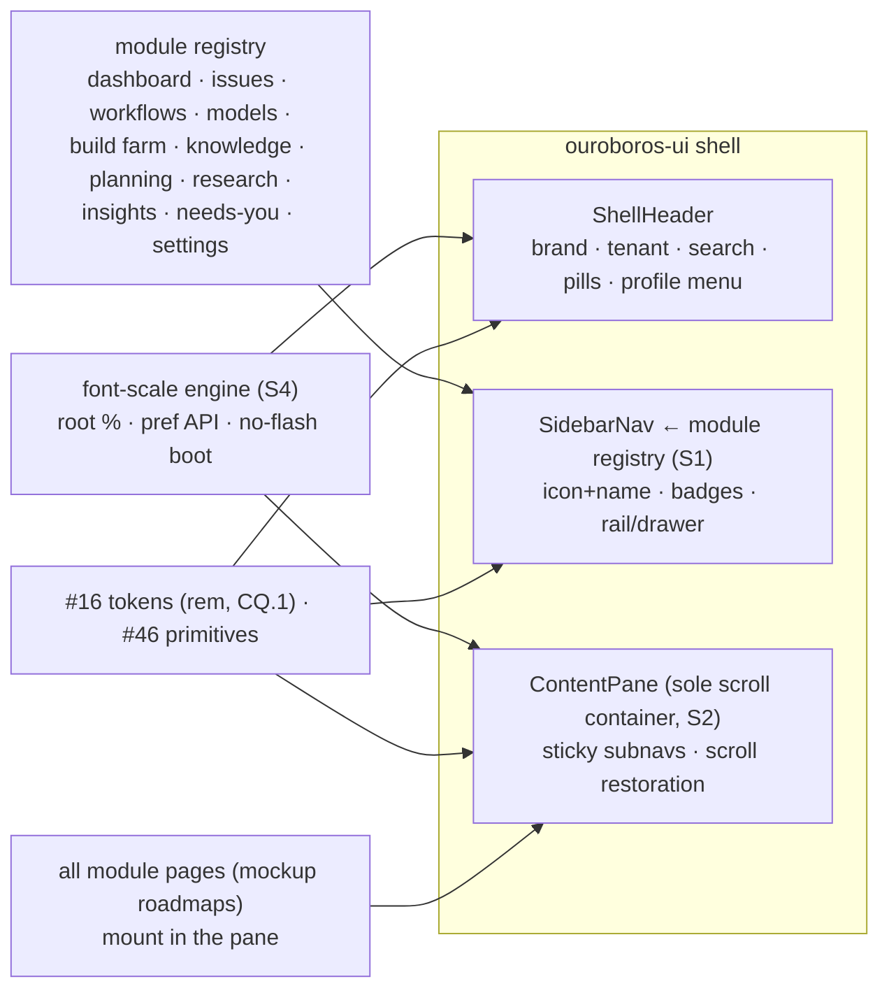
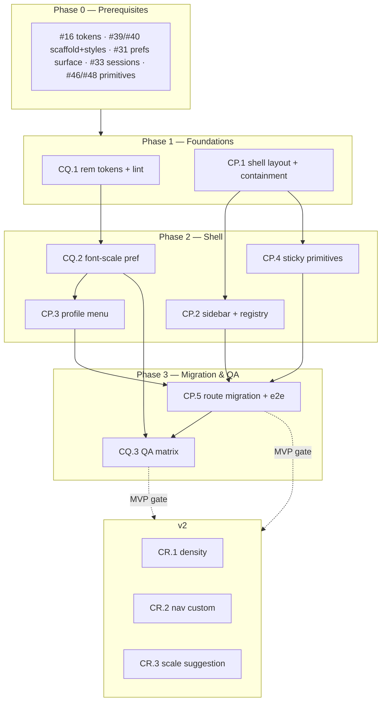
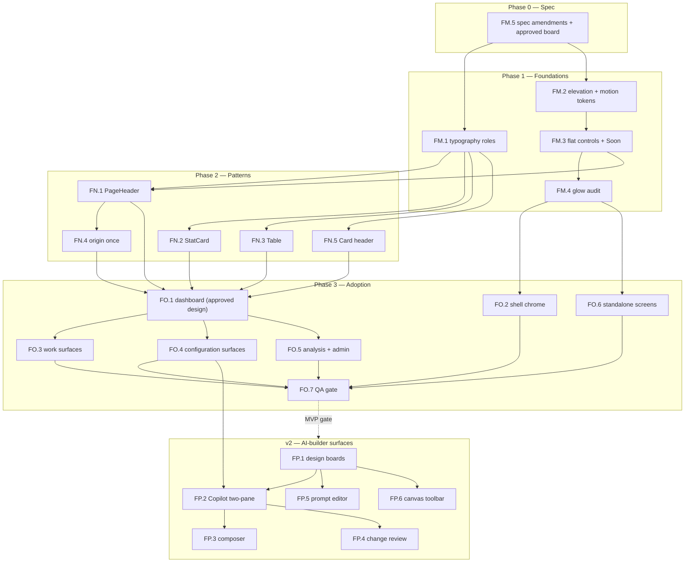

# Roadmap — Application Shell & UI/UX Standards

## Description

> Modify the roadmaps in the docs directory to make sure that UI/UX components
> are well designed and covered. Also, the layout of the application should be
> the following: top header with the name of the application in the upper
> left-hand corner, profile information in the upper right-hand (as with
> standard SaaS applications). The navigation portion of the application should
> be a sidebar on the left-hand side of the screen, and all of the content
> displayed for the roadmaps appears on the right side. Left-side navigation
> menu items should correspond to the roadmap application, along with an icon
> and name. The screen on the right, only the content is scrollable, not the
> entire screen. Make sure to follow this design with all roadmaps. Once this
> design feature is covered, we can start on creating issues, but not until all
> of the items have been covered. Make sure the UI/UX components are well
> thought out and designed. Having a setting to allow for the font size to be
> adjusted would also be ideal, as some monitors are very high resolution, and
> the text can be hard to read.

**Addendum 2026-11-12 — professional polish (epics FM–FP).** A second request
extends this roadmap:

> Review the UI/UX of the application, and suggest an update to the UI/UX that
> makes it look more professional and user-friendly for building applications
> using AI and LLMs. It already looks good, but it is missing that professional
> polish.

Carried out as: add a UI polish epic set from the approved dashboard
before/after design — (1) tokens and primitives: typography roles, elevation
and motion tokens, flat primary button, glow only for live indicators, flat
active nav; (2) a shared page header pattern, a stat card with a fixed label
row, tables with one-line truncated titles, data origin shown once per page,
a visible "Soon" state for unshipped actions; (3) dashboard adoption of the
approved design; (4) Copilot two-pane layout with a docked composer, the
inspector prompt editor, the canvas toolbar.

The review's one-line finding: **the chrome is louder than the work.** The
approved direction is "quiet the chrome, raise the work" — the brand stays in
the wordmark, the page title and the live indicators, and everything else
steps back so loops, models and prompts are what the eye lands on.

## Context & Existing Work (duplicate-avoidance survey)

Surveyed 2026-08-09.

**Design source of truth:**
[`docs/DESIGN_SYSTEM_APP_SHELL.md`](DESIGN_SYSTEM_APP_SHELL.md) — the shell
specification this roadmap implements (header anatomy, sidebar registry,
content-only scrolling, component standards, font-size preference). The
mockups (`docs/mockups/*.html`) remain authoritative for **page content**;
their topbar chrome is superseded by the spec.

**Overlapping work and dispositions:**

| Existing work | Disposition under this roadmap |
|---|---|
| Scaffolding #41 (`App shell — top bar, navigation, footer`, filed) | **Re-scoped by CP.1/CP.2** — header keeps brand/tenant/profile; nav links move to the sidebar; scroll containment added. Amendment comment posted at filing. |
| Scaffolding #16 design tokens, #40 global styles, #46 primitives, #48 workshop | **Amended/extended** — CQ.1 converts the type scale to rem and adds the lint rule; shell primitives (ShellHeader, SidebarNav, ContentPane, StickyBar) join the #46 set with #48 workshop stories. |
| Scaffolding #17 runtime theme engine (`data-theme`, persisted, no flash) | **Pattern reused** — CQ.2 applies font scale at boot the same way (server pref + localStorage mirror, no flash). |
| Mockup 17 (Settings) roadmap BQ–BT | **Amended** — Settings → Appearance gains the font-size control (CQ.2); noted in that roadmap's compliance section. |
| Mockup 16 (Needs You) roadmap BM–BP | **Consumed** — the sidebar's Needs You badge renders its live count via the CP.2 badge slot. |
| Every mockup roadmap's route/frame + e2e issues (AA.1, AE.1, CI.1, CN.1, AM.1, …) | **Amended in place** — each roadmap now carries a **UI/UX Shell Compliance** section listing its affected issues; those issues mount in the content pane and register sidebar entries instead of topbar links. |
| Login/BetterAuth roadmap, Onboarding (13) | **Outside the shell** — standalone screens; §3 standards + font scaling still apply (their compliance sections say so). |
| #56 e2e smoke | **Extended** — CP.5 adds the shell leg (fixed chrome under scroll, nav states); CQ.3 adds the font-scale screenshot matrix as leg 8, with its own three-minute budget. |
| Pluggable ticket sources requirement (description boilerplate) | **Already satisfied** by WF Epic Q; nothing source-related in shell work. |

Epic letters continue the sequence (…CK–CO): this roadmap uses
**CP, CQ, CR**.

### Polish addendum survey (2026-11-12)

Reviewed from the committed docs screenshots
(`ouroboros-docs/static/img/screenshots/`, both themes) and the token and
primitive sheets — not from a running stack. The approved design is the
dashboard before/after board
(<https://claude.ai/artifact/FTRY56cbz5nZierCsaiDP8>, dark theme, private to
its owner until shared); FM.5 commits a capture of it under `docs/design/`.

**What the review measured:**

| Finding | Evidence |
|---|---|
| The display face carries every heading | `h1`–`h6` all take `--f-disp` ([`globals.css`](../ouroboros-ui/app/globals.css) heading reset); uppercase tracked Chakra Petch renders uneven gaps in card titles ("VERIFICAT ION GAT ES") |
| Labels shout | 82 `text-transform: uppercase` rules and 516 `--f-mono` declarations across 64 sheets; `<Eyebrow>` in 57 components |
| Glow stands in for elevation | `--accent-glow` used 43 times, on the primary button ([`ui.css`](../ouroboros-ui/app/ui/ui.css) `.ou-btn--primary`) and the active nav item as well as live things; `tokens.css` has no shadow or motion tokens; 24 `transition` rules in 64 sheets |
| Tables wrap at 1440px | Dashboard issue titles wrap to four lines; routing-matrix model ids wrap to three or four |
| Stat cards misalign | Origin badges sit in the label row, wrap, and push values to different baselines |
| Origin is said many times | One dashboard view carries the strip, the origin switch and seven "Demo data" badges |
| Page heads vary | Slogan titles, eyebrows, actions above or beside the title, alerts inside the head (Copilot) |
| Unshipped actions look broken | "Pull next issue" is `aria-disabled` with its why-line in a tooltip only |
| AI-builder surfaces are the most cramped | Copilot conversation ≈ 330px in a three-column layout; prompt template is a small textarea; the canvas toolbar spends two lines on a help sentence |

**Overlapping work and dispositions:**

| Existing work | Disposition under the addendum |
|---|---|
| #16 design tokens, [`DESIGN_TOKENS.md`](DESIGN_TOKENS.md), `scripts/verify-tokens.sh` | **Extended** — FM.1/FM.2 add role and elevation/motion tokens to both sheets; the two dark blocks stay identical and the verifier is taught the new names. |
| #46 primitives, #48 workshop | **Extended** — FM.3 restyles Button/Chip; FN.1–FN.5 add PageHeader and revise StatCard, Table, Card; each gets a workshop story. |
| [`DESIGN_SYSTEM_APP_SHELL.md`](DESIGN_SYSTEM_APP_SHELL.md) § 2 (page head = eyebrow, h1, subline, actions) and § 3 | **Amended by FM.5** — the page head loses its eyebrow; § 3 gains typography roles, elevation and the origin rule. § 3.5 Honesty and § 3.6 Density are unchanged and are what the Soon tag and the denser tables implement. |
| CP.2 (#644) sidebar active state | **Amended** — the active item becomes a flat fill (FM.4/FO.2); registry, rail and drawer are untouched. |
| CQ.3 (#650) readability matrix and its twelve baselines | **Baselines refreshed** by every FM/FN/FO issue that changes a photographed page; the 150% audit is the gate for FO.7. |
| CR.1 (#651) density modes | **Unaffected** — the polish tightens the default rhythm once; comfortable/compact remains v2. |
| Live Loop DJ.3 (#1316) origin strip and badges ([`app/origin/`](../ouroboros-ui/app/origin/)) | **Amended by FN.4** — badges render only where a view mixes origins; a page whose strip already names its one origin carries no per-card badges. |
| Mockup 02 roadmap (dashboard), I.1 (#80) | **Amended by FO.1** — page head, stat row, active-loops table and pulse card take the approved design. |
| Mockup 20 roadmap (Workflow Copilot), mockup 04 (builder), mockup 05 (code) | **Amended by FP.2–FP.6** after FP.1's boards are approved. |
| `docs/mockups/*.html` and `assets/ouroboros.css` | **Not restyled** (decision P8) — they remain the truth for page content, not for chrome or type. |
| Search hint `⌘K` / `Ctrl K` | **Already platform-aware** ([`search-pill.tsx`](../ouroboros-ui/app/shell/search-pill.tsx)); the docs screenshots show `Ctrl K` because they are captured on Linux. No work. |
| Blank "Elapsed" column in docs screenshots | **A capture mask over live timers**, not a layout fault. No work. |

Epic letters continue the repository's sequence (…FE–FL, the RC1 and RC2
roadmaps): the addendum uses **FM, FN, FO, FP**.

## Decisions proposed by this roadmap (validate before issue creation)

| # | Decision | Rationale |
|---|----------|-----------|
| S1 | **The shell is a registry-driven composition**: modules register sidebar entries (icon, label, route, sort, badge slot, capability); the sidebar renders the registry — adding a module never edits shell code | Twelve modules and counting; hand-maintained nav is a merge-conflict machine. |
| S2 | **One scroll container**: `html/body` locked; the content pane owns vertical scroll; sticky page chrome sticks within it; wide content scrolls in its own wrappers | The description's core requirement, made structural instead of per-page discipline. |
| S3 | **Sidebar states**: 240px expanded ⇄ 64px icon rail (persisted per user), rail default < 1024px, overlay drawer < 768px; names become tooltips in rail mode | Icon+name at desktop, graceful degradation below, no dead nav on mobile. |
| S4 | **Font scale = five root-percentage steps (87.5–150%), rem-everything enforced by lint**, server-persisted per user with a localStorage no-flash mirror (the #17 pattern), controls in the profile menu and Settings → Appearance | Scales every surface with one mechanism; respects browser zoom; the description's high-DPI readability ask. |
| S5 | **Subnavs stay in the content pane** — the sidebar is one level deep; Models/Workflows tab sets keep their in-page tabs (sticky in-scroll) | Matches the mockups' page anatomy; a nested sidebar tree would fork every existing subnav design. |
| S6 | **Compliance is documented per roadmap**: every roadmap in `docs/` carries a UI/UX Shell Compliance section naming its amended issues — filing reads those sections and posts the amendments | "Make sure to follow this design with all roadmaps," auditable at a glance. |
| S7 | **Labels**: new `shell`; **Milestones**: `App Shell MVP` / `App Shell v2` created at filing | House rule for the filing pass. |

**Polish addendum (2026-11-12) — validated at filing, 2026-11-12:**

| # | Decision | Rationale |
|---|----------|-----------|
| P1 | **The display face has two jobs**: the wordmark and the page title. Card, section and dialog headings are IBM Plex Sans 600, sentence case | Chakra Petch is the brand's voice; used on every heading it stops being a voice and becomes noise, and its uppercase tracking renders unevenly. |
| P2 | **Mono is for identifiers, code and data numerals.** Labels — stat labels, table heads, card titles, nav — are sentence-case Plex Sans with no tracking | 516 mono declarations make everything look like an identifier, so real identifiers stop standing out. |
| P3 | **Glow means live, and nothing else.** Depth comes from two shadow tokens; the primary button is a flat accent fill; the active nav item is a flat raised fill | `DESIGN_TOKENS.md` already reserves the glow for live things; the button and the nav were the exceptions that diluted it. |
| P4 | **One page head**: plain title (the module's name or the entity's name), a one-line status subline, actions on the right with at most one primary, alerts full-width beneath. No eyebrow, no slogan title | Amends `DESIGN_SYSTEM_APP_SHELL.md` § 2. The sidebar already says where the reader is; a status line is worth more than a strapline. |
| P5 | **Origin is stated once.** Where a page holds a single non-live origin, the strip says so and no card or row repeats it; badges appear only in views that mix origins | Amends DJ.3 (#1316). The honesty rule is kept — nothing non-live is ever unlabelled — without seven labels for one fact. |
| P6 | **An unshipped action wears a visible "Soon" tag** and keeps its why-line; the page's primary is always an action that works today | § 3.5 Honesty asks that "soon" surfaces be labelled; a grey button with a tooltip reads as broken. |
| P7 | **Every polish PR recaptures the screenshots it changes and refreshes the e2e baselines it changes, in the same PR** — for a token or primitive change that is every id | `CONVENTIONS.md` § 11 as written; the capture is scripted (`yarn screenshots`), so the cost is machine time, and a stale site is the alternative. |
| P8 | **The mockups are not restyled.** `docs/mockups/` stays the truth for page *content*; its README gains a note that chrome and type follow the design-system spec | Twenty-three static pages restyled by hand buys nothing the running product does not show better. |
| P9 | **AI-builder surfaces are design-first**: FP.1's boards are approved before FP.2–FP.6 start | Only the dashboard has an approved design; Copilot, inspector and canvas are layout changes, not restyles. |
| P10 | **The light palette is derived, not separately designed**: the same rules applied to the light tokens, gated by FO.7 | The approved board is dark only; both themes are a house rule. |
| P11 | **Labels**: new `polish`; **Milestones**: `UI Polish MVP` / `UI Polish v2` created at filing | House rule for the filing pass. |

## Architecture Overview



## MVP Definition

The MVP is **the spec'd shell live under every existing page**. It is done
when, against the compose stack:

1. The shell renders per
   [`DESIGN_SYSTEM_APP_SHELL.md`](DESIGN_SYSTEM_APP_SHELL.md) §1 in both
   themes: fixed header (brand + tenant left; search, pills, profile menu
   right; **no nav links**), fixed sidebar (registry-driven icon+name
   entries, active states, Needs You badge, collapse rail, drawer mode),
   and the content pane as the **only** scroll container (header/sidebar
   provably fixed under scroll; sticky subnavs stick in-pane).
2. Every existing route mounts in the pane with its mockup content anatomy
   intact; #49 placeholder pages included; login/onboarding render
   standalone as spec'd.
3. The profile menu works: account identity, font-size quick control, theme
   toggle, settings link, sign out.
4. **Font scaling works end to end**: five steps, rem-based type everywhere
   (lint green), server-persisted + no-flash boot, controls in profile menu
   and Settings → Appearance; 150% passes the clipping/overflow QA bar.
5. Keyboard/a11y: sidebar arrow navigation, `aria-current`, focus rings,
   AA contrast at every scale in both themes.
6. #56 gains the shell leg; the font-scale screenshot matrix runs in CI.

**Explicitly v2 (milestone `App Shell v2`):** density modes (CR.1), nav
customization (CR.2), display-aware scale suggestion (CR.3).

### UI Polish MVP (addendum, milestone `UI Polish MVP`)

The polish MVP is **the approved dashboard live, and every other page
speaking the same visual language**. It is done when, against the compose
stack:

1. `/dashboard` matches the approved board in the dark theme and its derived
   equivalent in the light theme: plain page head, origin stated once, four
   stat cards on one baseline, one-line loop rows, a pulse card sized to its
   content.
2. The display face appears only in the wordmark and page titles; no card
   title, table head, stat label or nav label is uppercase, tracked or mono.
3. `--accent-glow` paints only live indicators; the primary button and the
   active nav item are flat; cards and overlays take their depth from the
   shadow tokens; hover, focus and open/close transitions use the motion
   tokens and honour `prefers-reduced-motion`.
4. Every module page uses the shared PageHeader, StatCard, Table and Card
   patterns — no page carries its own head markup, and no unshipped action
   looks merely disabled.
5. Both themes pass AA contrast; the 150% readability audit (leg 8) is green;
   the docs site's screenshots and pages describe what ships.

**Explicitly v2 (milestone `UI Polish v2`):** the AI-builder surfaces —
Copilot layout and composer, proposed-change review, the inspector prompt
editor, the canvas toolbar (epic FP), each behind FP.1's design approval.

## Epics, Labels & Milestones

Each epic is a parent tracking issue on GitHub; every roadmap issue below is filed as
one of its sub-issues (GitHub Relationships).

| Epic | GitHub | Status | Name | Goal | Modules | Milestone |
|------|:------:|:------:|------|------|---------|-----------|
| CP | #640 | 🟡 Open | Application Shell & Navigation | Header, sidebar registry, scroll containment, migration, e2e | ouroboros-ui | App Shell MVP |
| CQ | #641 | 🟡 Open | Readability & Type Scale | rem tokens + lint, font-size preference, QA matrix | ouroboros-ui, ouroboros-rest | App Shell MVP |
| CR | #642 | 🟡 Open | Shell Enhancements (v2) | Density modes, nav customization, display-aware scaling | ouroboros-ui | App Shell v2 |

Issue naming: `<project>: [<epic>.<issue>] <title>`. Labels: existing set
(`mvp`, `v2`, `ui`, `design`, `rest`, `ci`) **plus new `shell`** (decision
S7). Milestones **`App Shell MVP`** / **`App Shell v2`** created at filing.
Complexity chips: **XS · S · M · L**.

**Polish addendum — filed 2026-11-12:**

| Epic | GitHub | Status | Name | Goal | Modules | Milestone |
|------|:------:|:------:|------|------|---------|-----------|
| FM | #2029 | 🟡 Open | Visual Foundations | Typography roles, elevation and motion tokens, flat controls, glow for live only, spec amendments | ouroboros-ui, docs, ouroboros-docs | UI Polish MVP |
| FN | #2030 | 🟡 Open | Page Patterns | PageHeader, StatCard, Table and Card patterns; origin stated once | ouroboros-ui, ouroboros-docs | UI Polish MVP |
| FO | #2031 | 🟡 Open | Adoption | The approved dashboard, the shell, every module page, and the QA gate | ouroboros-ui, ouroboros-docs, tests | UI Polish MVP |
| FP | #2032 | 🟡 Open | AI-Builder Surfaces (v2) | Copilot layout and composer, change review, prompt editor, canvas toolbar | ouroboros-ui, ouroboros-docs | UI Polish v2 |

Labels for FM–FP: the existing set (`mvp`, `v2`, `ui`, `design`, `shell`,
`dashboard`, `copilot`, `studio`, `workflow`, `ci`) **plus new `polish`**
(decision P11, defined in `.github/labels.yml`). Milestones **`UI Polish MVP`** /
**`UI Polish v2`** were created at filing. Each epic also carries a
`[<epic>.V]` validation ticket, the repository's standing gate for closing
an epic.

---

## Epic CP (#640) — Application Shell & Navigation (`ouroboros-ui`)

| Ref | GitHub | Status | Title | Summary | Labels | Parallel | MVP | Complexity | Affected Modules |
|-----|:------:|:------:|-------|---------|--------|:--------:|:---:|:----------:|------------------|
| CP.1 | #643 | 🟢 Done | ouroboros-ui: [CP.1] Shell layout — header, grid & scroll containment | Fixed header + shell grid; content pane as sole scroll container | mvp, shell, ui, design | N (after #39, #40, #16) | Y | L | ouroboros-ui |
| CP.2 | #644 | 🟢 Done | ouroboros-ui: [CP.2] Sidebar navigation & module registry | Registry-driven icon+name nav, active states, badges, rail/drawer | mvp, shell, ui, design | N (after CP.1) | Y | L | ouroboros-ui |
| CP.3 | #645 | 🟢 Done | ouroboros-ui: [CP.3] Profile & session menu | Avatar menu: identity, font-size control, theme, settings, sign out | mvp, shell, ui | N (after CP.1, #33, CQ.2) | Y | M | ouroboros-ui |
| CP.4 | #646 | 🟢 Done | ouroboros-ui: [CP.4] In-pane chrome standards & primitives | StickyBar/subnav primitives, scroll restoration, anchor behavior | mvp, shell, ui, design | N (after CP.1) | Y | M | ouroboros-ui |
| CP.5 | #647 | 🟢 Done | ouroboros-ui: [CP.5] Route migration & shell e2e leg | All routes mounted in the pane; #41/#49 amendments; #56 shell leg | mvp, shell, ui, ci | N (after CP.2–CP.4) | Y | M | ouroboros-ui, .github |

### Issue CP.1 — ouroboros-ui: [CP.1] Shell layout — header, grid & scroll containment

> **GitHub issue:** #643 · **Status:** 🟢 Done · **Parent epic:** #640

> **Shipped.** The frame is
> [`app/shell/app-shell.tsx`](../ouroboros-ui/app/shell/app-shell.tsx) over
> [`app/shell/shell.css`](../ouroboros-ui/app/shell/shell.css), and the re-scope #41 began
> is finished: header, sidebar slot, content pane, and — new with this issue — an overlay
> layer beside the pane rather than inside it.
>
> **The grid was already the specification's**, so the work here was the three things it
> was still missing. First, the sidebar's width became **one custom property**:
> `--shell-sidebar`, declared on the shell with all three of § 1.2's widths beside it
> (`15rem` expanded, `4rem` rail, `0` drawer, because a drawer is out of flow and the
> column it left has no width). The grid's first column stays `auto`, so CP.2 moves the
> sidebar between them by redefining one value and touching no layout. The rail is
> selected by the existing 1024px query; the **drawer is declared and not selected**,
> deliberately — CP.2 brings the hamburger that opens it, and a sidebar with no way to
> open it is navigation nobody can reach.
>
> Second, the header became **every slot § 1.1 names, in its order**: the brand (now
> linking to `/dashboard` rather than `/`, which since #45 only redirects there), the
> tenant chip, then search · live-loops · needs-you · notifications · profile menu. The
> chip and the pills draw what is true and no more — the chip names the workspace the
> session is acting in and an em dash when nothing is known, the counts stay em dashes
> for #78 — and switching from the chip is still #77, so it is drawn as a statement with
> a tooltip pointing at the account menu, which does switch today. The theme toggle and
> the settings gear stay in the row until CP.3 folds them into the profile menu.
>
> > **Amended 2026-08-14 by [#77](https://github.com/NobuData/ouroboros/issues/77) (H.1).**
> > The chip is a control now: `acme-robotics / helios-firmware ▾` over a menu that switches
> > workspace and picks a focus repository, so the caret this issue refused to draw is
> > earned and the tooltip pointing at the account menu is gone. The em dash stays for the
> > one state it is still the right answer to — a session that names no workspace, where
> > every branch of that menu would be about nowhere. #77 also lifted this shell's menu
> > keyboard into `app/shell/menu.ts` and its workspace write into
> > `app/shell/switch-workspace.ts`, both now shared with CP.3's account menu.
>
> > **Amended 2026-08-14 by [#78](https://github.com/NobuData/ouroboros/issues/78) (H.2).**
> > The two em dashes are counts, from the shared poll
> > ([#87](https://github.com/NobuData/ouroboros/issues/87)) rather than from a request of
> > their own: `3 loops live` and `Needs you · 2` in the seeded workspace. The honesty rule
> > this issue kept by drawing a dash is kept the other way round now — a pill with nothing
> > to report is **not drawn at all**, so an empty workspace gets a header with an empty slot
> > rather than a pair of noughts. `app/shell/loop-pills.tsx`, and the em dash survives
> > nowhere in this row except the chip's one state.
>
> Third, and the part with no precedent in the module: **the overlay layer**. § 1.3's last
> clause asks that dialogs, sheets and the palette render outside the pane and lock its
> scroll, and the subtlety is the lock.
> [`app/shell/pane-scroll.ts`](../ouroboros-ui/app/shell/pane-scroll.ts) explains it at
> length — `scrollbar-gutter: stable` reserves the scrollbar's width only for an `overflow`
> of `scroll` or `auto`, so locking with `hidden` un-reserves it and every line in the pane
> reflows *under the dialog just opened over it*. The gutter is measured before the class
> lands and handed back as padding, the depth is counted per element so two overlays cannot
> unlock each other, and the scroll position is restored last, after the overflow rule that
> would refuse it. [`overlay.tsx`](../ouroboros-ui/app/shell/overlay.tsx) is the React half:
> portal, Escape, backdrop, focus in and focus back out, Tab cycling inside the panel.
>
> The one control that opens one is the **search pill**, which is the honest way to have
> built the layer rather than a fixture — ⌘K (and Ctrl+K, since not every keyboard has the
> other) opens a panel that says the palette arrives with #79 instead of miming results.
> So the mechanism is exercised by the product and cannot rot before #79 replaces what is
> inside the frame.
>
> > **Amended 2026-08-14 by [#79](https://github.com/NobuData/ouroboros/issues/79) (H.3).**
> > It has. The panel is now
> > [`app/shell/command-palette.tsx`](../ouroboros-ui/app/shell/command-palette.tsx) — a
> > combobox over an extensible action registry, navigation-scoped by that issue's own
> > decision — and the pill keeps only the opening. `ShellOverlay` gained one prop for it,
> > `initialFocus`: a palette opens to be typed into, and the box cannot take focus for
> > itself because React runs a child's effects before its parent's, which would record the
> > box rather than the pill as the element Escape has to give focus back to.
>
> **What is left to CP.5 (#647), by this roadmap's own split:** the two acceptance criteria
> that need a browser to be true — 5,000px of fixture content moving only the pane, and no
> pane-level horizontal scrollbar from 1280px to 3840px. Both are CSS here and asserted as
> CSS (`__tests__/shell/shell-styles.test.ts` reads the rules; jsdom computes no layout), and
> the pane carries `data-shell-pane` so that leg has one selector that means *the scroll
> container* — `regions.ts` says why an attribute rather than the id. Everything assertable
> without layout is: the layer is a sibling of the pane, the overlay portals into it, the
> lock takes and returns the gutter, and the position comes back.

- **Problem Statement:** The current #41 shell is a top bar with nav links
  and a page that scrolls whole. The spec demands the standard SaaS frame:
  fixed header (brand upper-left, profile upper-right), fixed sidebar slot,
  and a content pane that is the only thing that scrolls (spec §1.1, §1.3;
  decision S2).
- **Solution/Scope:** Rebuild the shell layout: CSS grid (`auto 1fr` rows ×
  `auto 1fr` cols), `html/body` locked; **ShellHeader** — brand mark +
  wordmark (→ Dashboard), tenant chip, right cluster (search pill wired to
  ⌘K, live-loops pill, notifications slot, profile-menu slot for CP.3);
  **ContentPane** — `overflow-y:auto`, `scrollbar-gutter:stable`, max
  content width 1440px centered, horizontal scroll forbidden at pane level
  (wide content uses per-widget wrappers — audit hook for CP.5); overlay/
  portal layer that locks pane scroll; both themes from #16 tokens; rem
  sizing throughout (CQ.1 coordination).
- **Acceptance Criteria:**
  - With 5,000px of fixture content, only the pane scrolls — header pixel-
    fixed (e2e-assertable via bounding boxes).
  - No horizontal scrollbar on the pane at 1280–3840px widths with seeded
    pages; overlays lock pane scroll and restore it.
  - Both themes; grid holds at all breakpoints (sidebar slot width
    variable per CP.2).
- **Parallelism/Dependencies:** Needs #39, #40, #16. Blocks CP.2–CP.5.
  Amends #41 (comment at filing).
- **Technical Stack:** Next.js app shell, CSS grid, #16 tokens.
- **Epic:** CP

```
html/body: overflow hidden ─▶ grid [header / sidebar | pane]
pane: overflow-y auto · gutter stable · max 1440px  ─▶ the ONLY scrollbar
```

### Issue CP.2 — ouroboros-ui: [CP.2] Sidebar navigation & module registry

> **GitHub issue:** #644 · **Status:** 🟢 Done · **Parent epic:** #640

> **Shipped.** The navigation is a **registry** — modules register entries and
> [`app/shell/sidebar-nav.tsx`](../ouroboros-ui/app/shell/sidebar-nav.tsx) renders whatever
> is registered. It names no module, and it did not change to gain one: the criterion
> *"adding a fixture registry entry renders a working nav item with zero shell edits"* is
> asserted in `__tests__/shell/sidebar-nav.test.tsx` against the real registry, seeded as
> production seeds it.
>
> Four files hold the model, and the split is deliberate.
> [`nav.ts`](../ouroboros-ui/app/shell/nav.ts) is pure — the entry type, the ordering rule,
> the capability filter, and the exact-plus-section route match — so every rule can be tested
> without a registry or a DOM. [`nav-registry.ts`](../ouroboros-ui/app/shell/nav-registry.ts)
> is the singleton, framework-free, with `registerNavEntry` handing back the way to remove an
> entry again (which is also why there is no reset hook production never calls).
> [`nav-modules.ts`](../ouroboros-ui/app/shell/nav-modules.ts) is the seed: the eleven § 1.2
> names, with **lucide** icons — the icon-set decision this issue was to record — registering
> themselves at import. [`use-shell-nav.ts`](../ouroboros-ui/app/shell/use-shell-nav.ts) is
> the one place either store meets React, as `useSyncExternalStore`.
>
> **Ordering is `sort` then id, never registration order**, which is import order and
> therefore a bundler's business: a sidebar that reordered itself between builds is one
> nobody could learn. The registry refuses an entry it cannot draw honestly — an off-origin
> route, a route another entry has claimed, a `soon` row that does not say what it waits for
> — because a registration that silently did nothing would be a module missing from the
> navigation with nothing anywhere saying why.
>
> **The badge is a name, not a number.** An entry declares the *source* it reads
> (`needs-you` declares `inbox`); whoever can compute a count publishes it with
> `setNavBadge`. Nothing does yet — that is BN.4 (#464) — so the badge is **absent**, and
> absent draws nothing. The #46 `Badge` primitive already refuses `0` for the same reason,
> so the rule is enforced once rather than restated here. Both publishers refuse to run
> outside the browser: a module singleton on the server is shared by every request the
> process handles, and a count or a capability set is an answer about one reader.
>
> **Three widths, one custom property, and the rail is a container query.** § 1.2's rail is
> reached two ways — the 1024px default and the reader's own chevron — and never by the
> drawer, which is 240px wide at every viewport. Rather than write the same declarations per
> trigger, `shell.css` makes the sidebar a container and asks the one question that matters:
> *is there room for the word?* The reader's choice is stamped on `<html>` and applied by a
> boot script before first paint, the #17 pattern exactly, so a sidebar collapsed last week
> is not collapsed again in front of them. `--shell-sidebar-choice` and `--shell-sidebar`
> are two properties on purpose: written as one, a stamped choice (a selector) would outrank
> the drawer breakpoint (a media query), and an expanded sidebar would still sit in the grid
> on a phone.
>
> **The drawer** is the sidebar out of flow below 768px, opened from a hamburger the header
> draws only at that width. It is focus-trapped, closes on Escape, on the ground behind it,
> on a link followed out of it, and on the window growing past the breakpoint — that last one
> is not cosmetic, because the trap reads the same flag. Closed, it is `visibility: hidden`
> rather than merely translated away: an off-screen sidebar that is still visible is one the
> keyboard tabs into. The trap itself moved to
> [`focus-trap.ts`](../ouroboros-ui/app/shell/focus-trap.ts), shared with CP.1's overlay —
> two surfaces that cover the page, one cycle between them.
>
> **The keyboard** is a roving tab stop: one entry in the tab order, arrows and Home/End
> between them, wrapping at both ends, and Enter needing no handler because every reachable
> entry is a real `<a href>`. Rows that lead nowhere stay `<span>`s and stay out of both the
> tab order and the ring. In rail mode the label is hidden **visually** and left in the
> accessibility tree — `display: none` would take it out and leave a column of unnamed icons
> for exactly the readers who cannot see icons — so a row is announced identically at both
> widths, count and all.
>
> **Capability gating hides, and hides by default**: an entry naming a capability nobody has
> published is not drawn, and a group with nothing left in it is not drawn either, hairline
> and all. Nothing seeded declares one, so the gate is inert until a module opts in; the
> direction it errs in is a missing entry rather than a visible link into a screen the
> service will refuse.
>
> **On the tooltip contrast criterion:** the rail's tooltip is the platform's own `title`,
> which no stylesheet can reach — its contrast is the operating system's, and the active and
> inactive treatments are CP.1's measured pair, unchanged. The remaining browser-only checks
> (both themes rendered, the drawer at a real 767px) belong to CP.5's e2e leg by this
> roadmap's own split, as CP.1's did.

- **Problem Statement:** Navigation moves from topbar links to a left
  sidebar of icon+name entries — driven by a registry so twelve modules
  (and future ones) register instead of editing shell code (spec §1.2;
  decisions S1, S3).
- **Solution/Scope:** **Module registry**: typed entries {id, icon, label,
  route, sort, group `primary|secondary`, badgeSource?, capability?};
  seeded with the eleven spec entries (Dashboard, Issues, Workflows,
  Models, Build Farm, Knowledge, Planning, Research, Insights ·
  Needs You, Settings) using lucide icons per the spec mapping (icon-set
  choice recorded in-issue). **SidebarNav**: renders groups; active state
  (accent inset + tint, section matching `/models/*`); badge slot (Needs
  You count via the mockup-16 counts endpoint when present, hidden
  otherwise — honesty); collapse control → 64px icon rail (labels →
  tooltips; state persisted per user), rail default < 1024px, overlay
  drawer < 768px (hamburger in header, focus-trapped, ESC closes);
  keyboard: arrow/Home/End roving focus, Enter activates,
  `aria-current="page"`; capability-gated entries hidden with no gap.
- **Acceptance Criteria:**
  - All eleven entries render with icons/names; active states correct
    across every seeded route including sub-routes; adding a fixture
    registry entry renders a working nav item with zero shell edits.
  - Rail + drawer modes verified with keyboard and screen-reader labels;
    collapse state survives reload; badge shows the seeded count and
    hides when the source is absent.
  - Both themes; AA contrast for active/inactive/tooltip states.
- **Parallelism/Dependencies:** Needs CP.1. Blocks CP.5. Feeds every
  roadmap's compliance amendment.
- **Technical Stack:** React, lucide-react, #46 primitives.
- **Epic:** CP

```
registry.register({id:'research', icon:telescope, label:'Research', route:'/research', sort:80})
sidebar: ▦ Dashboard ◉ Issues ⑂ Workflows ⬡ Models ⛭ Build Farm ▤ Knowledge
         ▦ Planning ◎ Research ∿ Insights ── ▣ Needs You ③ ⚙ Settings   [«]
```

### Issue CP.3 — ouroboros-ui: [CP.3] Profile & session menu

> **GitHub issue:** #645 · **Status:** 🟢 Done · **Parent epic:** #640

> **Shipped.** The § 1.1 menu, complete:
> [`app/shell/user-menu.tsx`](../ouroboros-ui/app/shell/user-menu.tsx) now carries the
> font-size stepper (live over #649's store, persisted through its Server Action), the
> theme control as three `menuitemradio`s over the #17 engine, the person's role beside
> their address, the keyboard-shortcuts sheet
> ([`app/shell/shortcuts-sheet.tsx`](../ouroboros-ui/app/shell/shortcuts-sheet.tsx), on
> the CP.1 overlay), and the sign-out and workspace switcher #721 had already built. Most
> of this ticket's surface predated it — the interaction shell, ESC, the roving ring,
> focus return, session truth — which is why building the menu before it had contents was
> worth it; what CP.3 added is everything between the identity block and the switcher.
>
> **The header gave up two controls, and the correction is recorded where they were
> promised a future.** § 1.1's upper-right enumeration draws the theme control *inside*
> the profile menu — no slot beside it — so the #42 cycling button left the row when the
> menu's radios learned its job (three visible states where the cycle folded them into
> one icon, `aria-checked` where it needed a marker dot). The engine was reused untouched,
> which is the half of ROADMAP_OOE_MVP's "second surface, not a replacement" note that
> survives; both passages that predicted the button would stay are amended in their own
> files. The disabled settings gear was absorbed by the menu's *Workspace settings* item —
> still honestly `aria-disabled` naming #491, because the issue's "links → `/settings`"
> clause has no route to point at until that ticket builds one. A link to a 404 is worse
> than a marked wait. *(#491 has since built the route: the item — and the tenant chip's — is
> the link to `/settings`.)*
>
> **The stepper's press is the preview.** `setFontScale` stamps `<html>` before the
> Server Action is even called, so "live preview as you step" is the ordering of two
> statements rather than a feature; the quiet-failure posture for the durable half is
> #649's, restated at the call site. The two step buttons are ordinary `menuitem`s in the
> ring — `aria-disabled` at the ends, never `disabled`, so the arrow walk never breaks —
> and the announcement rides the menu's existing `role="status"` region.
>
> **The role is fetched apart from the session, and remembered with its workspace.** The
> plugin's `organization.list` discards roles in its adapter, so the identity block asks
> `getActiveMemberRole` (one word for one workspace — `GET /api/v1/orgs` is for screens
> that need roles per row), collapses multi-role text with `primaryRole()`, and stores
> the answer *paired with the workspace it was asked for* — a stale answer voids itself
> by derivation the moment the session moves, with no reset to forget. Until an answer
> arrives the address stands alone: no guessed word, per § 3.5.
>
> **"Portals over the pane" is satisfied by construction, not by a portal.** The panel is
> an absolutely positioned child of the header — a sibling of the pane, which therefore
> cannot clip it — and `__tests__/shell/shell-styles.test.ts` pins the position and
> z-index facts. An actual portal through the overlay layer would buy nothing and cost
> the pane a scroll lock a menu must not take. The shortcuts sheet, which *is* a dialog,
> does ride the overlay layer, and lists only bindings that exist — ⌘K in the platform's
> own spelling through the search pill's exported `shortcutHint()`, the two roving rings,
> the dismissals — because documentation is held to the same honesty rule as controls.
>
> Proved in `__tests__/shell/user-menu.test.tsx` (stepper, radios, role, sheet, and the
> full keyboard path around them), `__tests__/shell/account.test.ts` (the role's five
> decisions), `__tests__/theme.test.ts` (`describeTheme`, moved with its function), and
> `__tests__/shell/shell-header.test.tsx`, which now asserts the two controls stay *out*
> of the row. **What CP.5 (#647) and CQ.3 (#650) then added, by this roadmap's own split:**
> the browser-observed legs — AA contrast in both palettes at 150%, measured over what the
> browser painted (`tests/e2e/support/contrast.ts`), and the stepper walked end to end
> against the store, 100% → 150% → 100%, in leg 7.
  with standard SaaS applications)" — the avatar must open a real account
  menu, and it is the spec'd home of the font-size quick control (spec
  §1.1, §4).
- **Solution/Scope:** Avatar button (initials/photo from the session) →
  menu: identity block (name, email, org role), **Font size** stepper
  (five steps, live preview as you step, persists via CQ.2's API),
  **Theme** toggle (reusing #17), links (Workspace settings → `/settings`,
  keyboard shortcuts sheet), **Sign out** (BA session end). Menu is
  keyboard-complete, closes on ESC/outside, portals over the pane.
- **Acceptance Criteria:** Menu renders session truth; font-size steps
  apply instantly and persist across reload/sign-in; theme toggle works
  from the menu; sign-out lands on login; full keyboard path; both
  themes.
- **Parallelism/Dependencies:** Needs CP.1, #33 (sessions), CQ.2 (pref
  API). 
- **Technical Stack:** React, #46 menu primitives, BA session client.
- **Epic:** CP

```
[KS ▾] ─▶ Ken Suenobu · ken@… · owner
        Font size  [A- ▪▪▪▫▫ A+]   Theme [◐]
        Workspace settings · Shortcuts · Sign out
```

### Issue CP.4 — ouroboros-ui: [CP.4] In-pane chrome standards & primitives

> **GitHub issue:** #646 · **Status:** 🟢 Done · **Parent epic:** #640

> **Shipped.** `StickyBar` and `PageSubnav` joined the #46 set
> ([`app/ui/sticky-bar.tsx`](../ouroboros-ui/app/ui/sticky-bar.tsx),
> [`app/ui/page-subnav.tsx`](../ouroboros-ui/app/ui/page-subnav.tsx)) over one stacking
> contract, [`app/ui/chrome.ts`](../ouroboros-ui/app/ui/chrome.ts): subnav above
> dirty-state bar above table header, each layer publishing its measured height as a
> custom property on the scroll container and the next offsetting by it, so the order
> holds at every font scale. The #46 Table grew the sticky-header recipe as a prop
> (`stickyHeader` — the wrapper opens up because sticky pins to the nearest scrollport,
> and the trade is documented once in `table.tsx`). The subnav preserves the mockups'
> underline gesture with the hue as a tone — 06's model purple included. **Scroll
> restoration** is the shell's ([`app/shell/pane-restoration.tsx`](../ouroboros-ui/app/shell/pane-restoration.tsx)):
> back/forward restores the pane per `pathname?search`, a push starts at the top, and a
> fragment push is left to the router — whose `scrollIntoView` the pane's
> `scroll-padding-top` offsets by the same published heights, which is the whole of the
> **anchor behaviour**. The demonstration is the workshop's first page,
> [`/workshop/chrome`](../ouroboros-ui/app/workshop/chrome-story.tsx) (seeding #48, whose
> tooling is v2): subnav + dirty bar + sticky table header over 48 rows, both themes, and
> — as the product's second in-shell route — the fixture the pane-memory e2e group in
> `tests/e2e/specs/shell.spec.ts` drives, running since CP.5 (#647) unparked the
> session-gated legs.

- **Problem Statement:** With one scroll container, every sticky behavior
  the mockup roadmaps assume (subnav tabs, dirty-state bars, table
  headers) must stick against the pane — a shared primitive, not
  twenty-two hand-rolled `position:sticky` fixes (spec §1.3; decision S5).
- **Solution/Scope:** #46 additions: **StickyBar** (sticks under the pane
  top; stacking contract when multiple stick — subnav above dirty-bar),
  **PageSubnav** (the Models/Workflows tab pattern as a pane-top sticky,
  preserving each mockup's active treatment), sticky table-header recipe
  for #46 Table; **scroll restoration** per route (back/forward restores
  pane position; push resets to top), anchor links scroll the pane with
  header offset; documentation page in the #48 workshop demonstrating
  all of it over a long fixture.
- **Acceptance Criteria:** Subnav + dirty-bar stack correctly while
  scrolling a long fixture; table headers stick in-pane; back/forward
  restores position (e2e); workshop story covers the contracts; both
  themes.
- **Parallelism/Dependencies:** Needs CP.1. Feeds every subnav-owning
  roadmap (06/07/21 Models tabs, 04/05/20 Workflows tabs, …).
- **Technical Stack:** React, #46, #48 workshop.
- **Epic:** CP

### Issue CP.5 — ouroboros-ui: [CP.5] Route migration & shell e2e leg

> **GitHub issue:** #647 · **Status:** 🟢 Done · **Parent epic:** #640

> **Shipped.** The migration itself had already happened route by route — every route the
> product serves mounts in the pane through `app/(app)/layout.tsx`, login renders
> standalone per spec § 5, and no topbar markup survives (grep finds prose mentions only)
> — so what this issue landed is the **proof and the audit trail**. The audit ran per
> route against the four questions (sidebar entry / PageSubnav / viewport-sticky /
> pane-level scroll): `/dashboard` passes all four with its entry lit; `/workshop/chrome`
> is declared **contextual** (a fixture, deliberately unregistered) and passes the rest;
> `/` is a redirect and `/login` is pre-shell by § 5. The **#56 shell leg** is
> `tests/e2e/specs/shell-nav.spec.ts` over `tests/e2e/support/shell.ts`: chrome
> bounding-boxes held still under a deep pane scroll on every in-shell route in both
> themes, the eleven-entry sidebar walk (one live link today, nine honest *soon* rows, a
> contextual route lighting nothing), rail persistence across reload, the drawer's
> keyboard path, and containment — no pane-level horizontal scroll, no viewport-fixed
> element, no topbar remnant. `scripts/verify-containment.sh` is the spot-verify: it
> plants each offence and requires the leg to go red naming it. **Unparking the sessions
> the leg needed** is this issue's one cross-service change: `docker-compose.e2e.yml`
> runs `rest` under `NODE_ENV=test` with `OURO_LISTEN_HOST=0.0.0.0` — a new validated
> override that moves the bind interface and nothing else — so `signIn()` answers from a
> cold compose and every session-gated leg (the dashboard's included) now runs.

- **Problem Statement:** Every existing route (#49 placeholders and the
  built pages) must mount inside the pane, the old topbar retired, and
  the shell's promises certified in e2e (decision S6's audit trail).
- **Solution/Scope:** Migrate all routes into the shell layout (topbar nav
  removed; login/onboarding excluded per spec §5); per-route audit
  against the compliance sections (sidebar entry present, subnav
  converted to PageSubnav, no viewport-sticky offenders, no pane-level
  horizontal scroll); amendments posted: #41 (re-scope), #49 (mount
  point), each mockup roadmap's frame issue (their compliance tables);
  **#56 shell leg**: header/sidebar fixed under deep scroll on three
  seeded pages, nav active states across a click-through of all eleven
  entries, rail + drawer modes, scroll restoration, both themes.
- **Acceptance Criteria:** Every seeded route renders in-shell with zero
  topbar remnants (grep + visual); e2e leg green from cold compose and
  fails when containment breaks (spot-verified); amendment comments
  drafted for filing.
- **Parallelism/Dependencies:** Needs CP.2–CP.4. MVP gate with CQ.3.
- **Technical Stack:** Next.js, Playwright.
- **Epic:** CP

```
e2e: fixed chrome ✓ · nav states ×11 ✓ · rail/drawer ✓ · restoration ✓ · themes ✓
```

---

## Epic CQ (#641) — Readability & Type Scale (`ouroboros-ui` + `ouroboros-rest`)

| Ref | GitHub | Status | Title | Summary | Labels | Parallel | MVP | Complexity | Affected Modules |
|-----|:------:|:------:|-------|---------|--------|:--------:|:---:|:----------:|------------------|
| CQ.1 | #648 | 🟢 Done | ouroboros-ui: [CQ.1] rem-based token scale & px lint | #16/#40 type+spacing to rem; stylelint rule bans px text | mvp, shell, ui, design | N (after #16, #40) | Y | M | ouroboros-ui, docs |
| CQ.2 | #649 | 🟢 Done | ouroboros-rest: [CQ.2] Font-size preference & no-flash boot | Pref API (5 steps), root application, localStorage mirror, controls | mvp, shell, ui, rest | N (after CQ.1, #31) | Y | M | ouroboros-rest, ouroboros-ui |
| CQ.3 | #650 | 🟢 Done | ouroboros-ui: [CQ.3] Readability QA & visual-regression matrix | Scale×theme×page screenshots in CI; 150% overflow audit | mvp, shell, ui, ci | N (after CQ.2, CP.5) | Y | M | ouroboros-ui, .github |

### Issue CQ.1 — ouroboros-ui: [CQ.1] rem-based token scale & px lint

> **GitHub issue:** #648 · **Status:** 🟢 Done · **Parent epic:** #641

> **Shipped.** The enforcement half of this ticket:
> [`ouroboros-ui/stylelint.config.mjs`](../ouroboros-ui/stylelint.config.mjs), run by
> `yarn lint` on every pull request, red on any absolute unit in `font-size`,
> `line-height` or the `font` shorthand.
>
> **The conversion this issue was written to do had already happened.** The issue body was
> drafted against a px-based token sheet (`--fs-13: 13px`), but the sheet that actually
> shipped with #16's adoption and #643's shell was rem from the start: every `--t-*` size,
> every `--lh-*` line height and the whole `--sp-*` scale in
> [`app/tokens.css`](../ouroboros-ui/app/tokens.css) — held byte-identical to
> `docs/design/tokens.css` by `scripts/verify-tokens.sh` — with zero px type sizes anywhere
> under `app/`. The audit that established this is recorded by the lint pass itself being
> green on the first run. Two acceptance criteria therefore land vacuously: at 100% the UI
> is pixel-identical because not one byte of CSS changed, and both themes are unaffected
> for the same reason — no screenshot diff was taken because there was nothing to compare,
> and the screenshot *infrastructure* remains CQ.3's (#650), where the scale × theme matrix
> actually needs it.
>
> **What was genuinely missing was the "keeps it that way" half.** `__tests__/styles.test.ts`
> already failed absolute `font`/`font-size` in shipped sheets, but it never covered
> `line-height`, and a vitest rule answers at test time, not at the moment the offending
> line is written. The stylelint rule closes both gaps and the two guards are held to the
> same vocabulary — the same seven absolute units, asserted against each other in
> [`__tests__/stylelint.test.ts`](../ouroboros-ui/__tests__/stylelint.test.ts), which also
> carries the acceptance criterion verbatim: red on a `font-size: 12px` fixture, green
> across every shipped sheet, under the *shipped* configuration rather than a copy.
>
> **The allowlist is the rule's scope, not a list.** Only the two type properties (and the
> shorthand that can smuggle them) are banned, so everything px is correct for — hairline
> borders, shadow offsets, `.sr-only`'s deliberately unscalable 1px boxes — never trips it.
> That is the shortest allowlist that can exist: empty, with the rationale in the config's
> own header and in `docs/DESIGN_TOKENS.md`, which already carried the rem scale table and
> now names the enforcement.
  px; the #16 token sheet and existing components carry px type sizes from
  the mockup CSS (spec §3.2, §4).
- **Solution/Scope:** Token sweep: type sizes, line heights, and key
  spacing in #16/#40 converted to rem (mockup px values ÷ 16 — visual
  parity at 100% verified by screenshot diff); component audit across #46
  and shipped pages; **stylelint rule** banning `px` in font-size/
  line-height (allowlist for hairline borders/shadows documented);
  token-sheet docs updated with the scale table.
- **Acceptance Criteria:** 100% scale is pixel-identical (diff within
  anti-aliasing tolerance); lint red on a px font-size fixture, green on
  the codebase; both themes unaffected.
- **Parallelism/Dependencies:** Needs #16, #40. Blocks CQ.2. Coordinates
  with #46/#48.
- **Technical Stack:** CSS custom properties, stylelint, screenshot diff.
- **Epic:** CQ

```
--fs-13: 13px  ─▶  --fs-13: 0.8125rem     html @100% ⇒ identical render
stylelint: "font-size: 12px" ─▶ ✗ error (use rem token)
```

### Issue CQ.2 — ouroboros-rest: [CQ.2] Font-size preference & no-flash boot

> **GitHub issue:** #649 · **Status:** 🟢 Done · **Parent epic:** #641

> **Shipped.** The engine end to end: a `user_preferences` table (V007), `GET`/`PATCH
> /api/v1/me/preferences` in a new
> [`preferences module`](../ouroboros-rest/src/modules/preferences/preferences.module.ts),
> and the browser half in [`app/font-scale.ts`](../ouroboros-ui/app/font-scale.ts) — the
> boot script in the root layout, the five `:root[data-font-scale]` rules in
> `globals.css`, the localStorage mirror, and the session-load reconciliation
> (`app/shell/font-scale-sync.tsx`, server wins). `preferences.integration-spec.ts` proves
> the criteria a mock cannot: the two-users-two-scales isolation, the 401, the 422 with
> the field named, and the upsert staying one row.
>
> **"BA user prefs" became a Flyway table, deliberately.** The issue sketched the
> preference on the account surface — BetterAuth `additionalFields` — and that is the one
> place it must not live: `betterauth-schema.sql` is a rendered snapshot of the library's
> expected DDL, held by ci/db, so a product column there is either snapshot drift or
> application-owned DDL, and D3 says Flyway owns every table. `ouroboros.user_preferences`
> references `"user"` and cascades with it; #31 turns out to have been the *pattern* (a
> session-authed, person-scoped surface), not a home — nothing called an
> account-preferences surface existed to build on.
>
> **The value is a label, not a number.** `font_scale` is text under a named CHECK, the
> house idiom, mirrored as a TS union and as the contract's string enum: `'100.0'` must
> not equal `'100'`, nothing does arithmetic with the step, and JSON would make a numeric
> 87.5 a float. The same five words appear in exactly four authorities — the CHECK, the
> schema union, the contract enum, the UI vocabulary — each held to the next by a test.
>
> **The controls are deliberately absent.** The stepper is CP.3's (#645, next in this
> stack); the Settings → Appearance row is #492's, whose issues-table row in the mockup-17
> roadmap already carries the amendment. What this ticket ships is the store both controls
> will subscribe to (`useFontScale()`), which is also how the "two controls stay in sync"
> criterion is met: there is one value for them to disagree about, and no code by which
> they could.
>
> **Reconciliation is one direction.** On session load the shell reads the account's scale
> and corrects the paint (a shared browser, a change made on another machine); it never
> PATCHes the value back, because a write that echoes a read is at best a no-op and at
> worst a race against a choice being made on another device. A control's press is the
> only writer: apply locally (the live preview), then `saveFontScale`, whose failure is
> quiet — the reader is already reading at the size they chose.
>
> **What CP.5 (#647) and CQ.3 (#650) then added, by this roadmap's own split:** the
> reflow-artifact criterion is a browser observation — jsdom computes no layout — and it is
> now leg 8's 150% audit, which measures clipping, chrome overlap and pane-level scroll
> rather than looking for them; the scale × theme × page screenshot matrix was CQ.3's
> entire remit and is its twelve committed baselines. The throttled-reload no-flash proof
> remains unwritten: the e2e suite deliberately does not run on pull requests, so it would
> be a nightly-only assertion about a first paint, and nothing has needed it.
  high-resolution monitors — per user, instant, persistent, and applied
  without a flash of wrong-size text (spec §4; decision S4).
- **Solution/Scope:** **Pref API**: user preference `font_scale` CHECK
  `87.5|100|112.5|125|150` on the account-preferences surface (BA user
  prefs; GET/PATCH under session auth); **application**: root
  `font-size: <scale>%` set via a boot inline script reading the
  localStorage mirror (the #17 no-flash pattern), reconciled with the
  server pref on session load; **controls**: profile-menu stepper (CP.3)
  and **Settings → Appearance** section (mockup-17 roadmap amendment —
  renders beside the theme control, with a live preview paragraph);
  anonymous screens (login) honor the local mirror; browser zoom
  untouched (percentages compose with it).
- **Acceptance Criteria:** Step change re-renders instantly with no
  reflow artifacts beyond size; reload at 150% shows no flash (throttled
  e2e); pref round-trips per user (two users, two scales, one browser
  verified); Settings control and menu stepper stay in sync; login page
  respects the mirror.
- **Parallelism/Dependencies:** Needs CQ.1, #31 (user prefs surface).
  Feeds CP.3; amends mockup-17 roadmap (BQ-epic Appearance region).
- **Technical Stack:** NestJS (prefs), boot script, React controls.
- **Epic:** CQ

```
PATCH /me/preferences {font_scale: 125} ─▶ html{font-size:125%} · localStorage mirror
boot: inline script reads mirror ─▶ no flash ─▶ session reconciles
```

### Issue CQ.3 — ouroboros-ui: [CQ.3] Readability QA & visual-regression matrix

> **GitHub issue:** #650 · **Status:** 🟢 Done · **Parent epic:** #641

> **Shipped.** The bar is **leg 8** of the #56 suite —
> [`tests/e2e/specs/readability.spec.ts`](../tests/e2e/specs/readability.spec.ts) — running
> under a **config and a three-minute budget of its own**
> (`playwright.readability.config.ts`), enforced as a `globalTimeout` rather than measured,
> and as its own CI step against the stack the smoke suite leaves up. It runs in well under
> the budget today. Three parts: the **matrix** ({100%, 125%, 150%} × both palettes × the
> roster, twelve baselines under `specs/__screenshots__/readability/`); the **150% audit**
> — pane-level horizontal scroll, clipped text measured as scroll size against client size
> on any element that clips its own label, the CP.4 sticky stack and the shell frame
> checked for overlap, and AA contrast computed over what the browser actually painted
> (`support/contrast.ts`); and the **roster**, below.
>
> **Four of the issue's five pages do not exist yet.** The routing matrix (#201), the
> registry table (#592), the research brief (#627) and settings (#491) each arrive with
> their own roadmap, so the matrix photographs the two dense pages that are built —
> `/dashboard`, and `/workshop/chrome` standing in for the routing matrix, being the only
> built page that stacks a subnav, a sticky bar and a sticky table header at once — and
> asserts the other four are **still 404**. No `test.fixme`: the day one of them lands, the
> leg goes red naming the page to photograph.
>
> **The manual pass found two offenders and both are fixed here.** The dashboard's pulse
> card put `Human interventions · 7 days` beside `0 this week` in a four-column card whose
> width is a fraction of the pane while its type is `rem`; at 150% the row needed ~290px of
> 212 and the excess left the card, left the grid and started the **pane** scrolling
> sideways — 21px of the § 1.3 violation this epic exists to prevent. The row now wraps,
> and nothing moves at 100% or 125%. The header's tenant chip truncated both halves with an
> ellipsis and no tooltip, leaving a pointer user with `acme-rob… / All rep…` and no way to
> see the rest; it now carries § 4's own remedy, a `title` with the visible text.
>
> **Spot-verified**, as acceptance criterion 2 asks:
> [`scripts/verify-readability.sh`](../tests/e2e/scripts/verify-readability.sh) plants four
> offences — a wrapper-less 3000px box, a squeezed sidebar label, the pane pulled under the
> header, the sticky bar dropped onto the subnav — and requires the audit to go red naming
> each. It runs in the nightly `failure-modes` job beside #647's containment script. The
> plants moved into `support/plants.ts`, one vocabulary for both.
>
> **#56 carries the scale-switch smoke** in leg 7: the reader steps 100% → 150% → 100%
> through the profile menu's own stepper, and the preference applies, survives a reload,
> and leaves the page usable at the top of the range.
>
> **The baseline refresh procedure** is `tests/e2e/README.md` § *Refreshing them*, and it
> was exercised once — which is how its load-bearing precondition came to be written down:
> the dashboard seed dates its rows relative to `now()`, so a week-old database volume has
> an empty *7 days* window and the first recording of the matrix caught a dashboard reading
> zeroes. A refresh starts with `down -v`.

- **Problem Statement:** Five scales × two themes × dense pages is a
  combinatorial surface where clipping and overflow hide; the QA bar must
  be automated (spec §4 QA).
- **Solution/Scope:** CI screenshot matrix: {100%, 125%, 150%} × {light,
  dark} × five representative seeded pages (densest: routing matrix,
  registry table, research brief, dashboard, settings) with diff
  baselines; **150% audit**: automated overflow detection (horizontal
  scroll at pane level, clipped text via scroll/client size probes) +
  documented manual pass fixing offenders (wrappers, truncation with
  tooltips); a11y contrast spot-checks at 150%; #56 gains the
  scale-switch smoke.
- **Acceptance Criteria:** Matrix runs in CI within budget (≤ 3 min);
  planted overflow fixture fails the audit; all five pages clean at
  150% in both themes; baselines documented for refresh.
- **Parallelism/Dependencies:** Needs CQ.2, CP.5. MVP gate with CP.5.
- **Technical Stack:** Playwright screenshots, CI.
- **Epic:** CQ

```
matrix: 3 scales × 2 themes × 5 pages ─▶ diffs ✓ · overflow probe ✓ · ≤3min
```

---

## Epic CR (#642) — Shell Enhancements (v2 · milestone `App Shell v2`)

| Ref | GitHub | Status | Title | Summary | Labels | Parallel | MVP | Complexity | Affected Modules |
|-----|:------:|:------:|-------|---------|--------|:--------:|:---:|:----------:|------------------|
| CR.1 | #651 | 🟡 Open | ouroboros-ui: [CR.1] Density modes | Comfortable/compact spacing presets composing with font scale | v2, shell, ui, design | Y | N | M | ouroboros-ui |
| CR.2 | #652 | 🟡 Open | ouroboros-ui: [CR.2] Navigation customization | Pin/reorder/hide sidebar entries per user; reset to default | v2, shell, ui | N (after CP.2) | N | S | ouroboros-ui |
| CR.3 | #653 | 🟡 Open | ouroboros-ui: [CR.3] Display-aware scale suggestion | First-run DPI/resolution heuristic suggests (never forces) a scale | v2, shell, ui | N (after CQ.2) | N | S | ouroboros-ui |

### Issue CR.1 — ouroboros-ui: [CR.1] Density modes

> **GitHub issue:** #651 · **Status:** 🟡 Open · **Parent epic:** #642

- **Problem Statement:** Font scale changes size, not breathing room;
  large-scale users on small screens (and dense-data users on large ones)
  want spacing presets.
- **Solution/Scope:** `comfortable` (default, current rhythm) and
  `compact` spacing token sets composing orthogonally with font scale;
  preference alongside `font_scale`; table/card paddings and row heights
  tokenized (extends CQ.1's sweep); QA matrix extended.
- **Acceptance Criteria:** Both modes at all scales pass the overflow
  audit; preference persists; no per-page overrides needed (token proof).
- **Parallelism/Dependencies:** After CQ.1/CQ.3.
- **Technical Stack:** CSS tokens, prefs API.
- **Documentation:** finding-your-way.mdx § Appearance (Density comfortable/compact beside font size, saved to the account); recapture user-guide.appearance
- **Epic:** CR

### Issue CR.2 — ouroboros-ui: [CR.2] Navigation customization

> **GitHub issue:** #652 · **Status:** 🟡 Open · **Parent epic:** #642

- **Problem Statement:** Different roles live in different modules; a
  build-farm operator wants Build Farm on top.
- **Solution/Scope:** Per-user sidebar order + hide (capability-gated
  entries excluded from hiding where required), drag-reorder in an edit
  mode, reset-to-default; registry order becomes the default layer.
- **Acceptance Criteria:** Reorder persists; hidden entries reachable via
  search/⌘K; reset restores registry order.
- **Parallelism/Dependencies:** Needs CP.2.
- **Technical Stack:** React dnd, prefs API.
- **Documentation:** finding-your-way.mdx § The sidebar (edit mode, reorder, hide, Reset to default; hidden stays reachable); new user-guide.shell.edit-nav, recapture user-guide.shell
- **Epic:** CR

### Issue CR.3 — ouroboros-ui: [CR.3] Display-aware scale suggestion

> **GitHub issue:** #653 · **Status:** 🟡 Open · **Parent epic:** #642

- **Problem Statement:** The user who needs 125% most is the one squinting
  at a 4K laptop panel who never opens Settings.
- **Solution/Scope:** First-run heuristic (devicePixelRatio + viewport)
  → one-time dismissible suggestion toast ("Text looks small on this
  display — try 125%?" with apply/preview); never auto-applies; per-device
  dismissal memory.
- **Acceptance Criteria:** Fires once per device profile; apply routes
  through CQ.2; dismissal sticks.
- **Parallelism/Dependencies:** Needs CQ.2.
- **Technical Stack:** React, heuristics.
- **Documentation:** finding-your-way.mdx § Appearance (the one-time scale suggestion toast: apply/preview, never auto-applies, per-display dismissal); no screenshot
- **Epic:** CR

---

## Epic FM (#2029) — Visual Foundations (`ouroboros-ui` + `docs`)

Tokens and primitives: small diffs that change every screen. Nothing here
moves layout.

| Ref | GitHub | Status | Title | Summary | Labels | Parallel | MVP | Complexity | Affected Modules |
|-----|:------:|:------:|-------|---------|--------|:--------:|:---:|:----------:|------------------|
| FM.1 | #2033 | 🟡 Open | ouroboros-ui: [FM.1] Typography roles — display, UI and mono | Display face only on wordmark + page title; sentence-case Plex labels; mono for identifiers and numerals; guard test | mvp, polish, ui, design | N (after FM.5) | Y | M | ouroboros-ui, docs, ouroboros-docs |
| FM.2 | #2034 | 🟡 Open | ouroboros-ui: [FM.2] Elevation & motion tokens | `--shadow-1/2`, `--dur-*`, `--ease-*` in both sheets and both themes; reduced-motion; verifier and preview updated | mvp, polish, ui, design | Y (with FM.1) | Y | S | ouroboros-ui, docs |
| FM.3 | #2035 | 🟡 Open | ouroboros-ui: [FM.3] Flat controls — button, chip, segmented control, Soon state | Flat primary; token-driven hover/focus transitions; one SegmentedControl; visible Soon tag on unshipped actions | mvp, polish, ui, design | N (after FM.2) | Y | M | ouroboros-ui, ouroboros-docs |
| FM.4 | #2036 | 🟡 Open | ouroboros-ui: [FM.4] Glow audit — live indicators only | 43 `--accent-glow` uses reduced to the live set; flat active nav; allowlist guard | mvp, polish, ui, shell | N (after FM.3) | Y | S | ouroboros-ui, ouroboros-docs |
| FM.5 | #2037 | 🟡 Open | docs: [FM.5] Design-system spec amendments & approved board | Spec § 2/§ 3 and token doc amended for P1–P6; approved board captured into `docs/design/`; mockups README note | mvp, polish, design | N (first) | Y | S | docs |
| FM.V | #2056 | 🟡 Open | ouroboros: [FM.V] Validate Epic FM — Visual Foundations | Validation gate: the epic's criteria, suites and docs hold together on one `main` commit | mvp, polish, validation | N (after every work ticket) | Y | S | ouroboros-ui |

### Issue FM.5 — docs: [FM.5] Design-system spec amendments & approved board

> **GitHub issue:** #2037 · **Status:** 🟡 Open · **Parent epic:** #2029

- **Problem Statement:** The spec is the source of truth and it currently
  says the opposite of the approved design in two places: § 2 defines the
  page head as "eyebrow, h1, subline, actions", and nothing limits the
  display face or the glow. Work that follows the design would violate the
  spec, and work that follows the spec would undo the design.
- **Solution/Scope:** Amend
  [`DESIGN_SYSTEM_APP_SHELL.md`](DESIGN_SYSTEM_APP_SHELL.md): § 2 page frame
  per P4 (title, status subline, actions with at most one primary, alerts
  beneath; no eyebrow); § 3 gains items for typography roles (P1, P2),
  elevation and glow (P3), origin stated once (P5) and the Soon tag (P6).
  Amend [`DESIGN_TOKENS.md`](DESIGN_TOKENS.md) § Type with a role table
  (which family for which job) and a placeholder section for FM.2's tokens.
  Commit the approved board as `docs/design/polish/dashboard-before.png` and
  `dashboard-after.png` with a short `README.md` naming what changed and
  why. Add the P8 note to `docs/mockups/README.md`. Source: the approved
  board and this roadmap's survey table.
- **Acceptance Criteria:**
  - § 2 and § 3 state P1–P6 with no sentence left that contradicts them.
  - The board's two captures are committed and linked from the spec.
  - `docs/mockups/README.md` says chrome and type follow the spec.
  - No application code changes.
- **Parallelism/Dependencies:** First. Blocks FM.1–FM.4 and FN.1.
- **Technical Stack:** Markdown.
- **Documentation:** none — internal-only change (design specification;
  nothing a person meets changes until FM.1).
- **Epic:** FM

```
spec § 2:  eyebrow · h1 · subline · actions
       ─▶  title · status subline · actions(≤1 primary) / alerts beneath
```

### Issue FM.1 — ouroboros-ui: [FM.1] Typography roles — display, UI and mono

> **GitHub issue:** #2033 · **Status:** 🟡 Open · **Parent epic:** #2029

- **Problem Statement:** Every heading level takes Chakra Petch, labels are
  uppercase tracked mono, and the result reads as a console skin rather than
  a working tool. Uppercase tracked Chakra Petch also renders uneven gaps
  ("CONVERSAT ION"). Identifiers — the one thing mono is for — no longer
  stand out, because everything is mono.
- **Solution/Scope:** In [`globals.css`](../ouroboros-ui/app/globals.css),
  the heading reset gives `h2`–`h6` `--f-ui`; `--f-disp` stays on `h1` and
  the wordmark. Sweep the 64 sheets: card titles, section heads, table
  heads, stat labels, tab labels and nav labels become sentence-case
  `--f-ui` with no `text-transform` and no `--tr-*` tracking; mono stays on
  identifiers (issue numbers, workflow names, model aliases, paths, hashes),
  code and data numerals. Label strings that were authored in capitals are
  re-cased at the source. `Eyebrow` stays in the primitive set for the few
  in-card uses that survive review, but leaves every page head (FN.1 removes
  those call sites). Add a guard: a test that fails when `--f-disp` or
  `text-transform: uppercase` appears outside a short named allowlist, in
  the manner of `__tests__/styles.test.ts`. Token sheet unchanged except
  comments; `DESIGN_TOKENS.md` § Type role table filled in.
- **Acceptance Criteria:**
  - `--f-disp` is referenced only by the wordmark and page-title rules; the
    guard test is red on a planted `h3 { font-family: var(--f-disp) }`.
  - Uppercase rules drop from 82 to the allowlist (target ≤ 5, each named
    with its reason).
  - No visible label is uppercase or tracked on the dashboard, routing
    matrix, Copilot and PR verification pages, in both themes.
  - Readability leg 8 green at 150%; AA contrast unchanged.
- **Parallelism/Dependencies:** After FM.5. Parallel with FM.2. Blocks FN.*.
- **Technical Stack:** CSS custom properties, vitest style guard, stylelint.
- **Documentation:** User Guide — every page that quotes a label in
  capitals is re-cased to match (search `ouroboros-docs/docs` for the
  re-cased strings); recapture **all** screenshot ids (P7) and refresh the
  readability baselines.
- **Epic:** FM

```
h1 .............. Chakra Petch 600      (page title, wordmark)
h2–h6, labels ... IBM Plex Sans 600/500 sentence case, no tracking
#482 · coder-max · boot/** ... IBM Plex Mono (identifiers, numerals)
```

### Issue FM.2 — ouroboros-ui: [FM.2] Elevation & motion tokens

> **GitHub issue:** #2034 · **Status:** 🟡 Open · **Parent epic:** #2029

- **Problem Statement:** [`tokens.css`](../ouroboros-ui/app/tokens.css) has
  no shadow and no motion tokens. Cards sit flat on the ground colour,
  overlays borrow the glow for depth, and there are 24 `transition` rules in
  64 sheets, so hover, focus and open/close states snap.
- **Solution/Scope:** Add to all three palette blocks (shadows are colour
  literals, so they belong there): `--shadow-1` (cards, raised controls) and
  `--shadow-2` (menus, dialogs, toasts), tuned per theme. Add to `:root`
  (theme-independent): `--dur-fast` (≈120ms), `--dur-base` (≈200ms),
  `--ease-standard`. Apply `--shadow-1` to `Card` and `--shadow-2` to the
  overlay, menu and toast surfaces. One global
  `@media (prefers-reduced-motion: reduce)` rule zeroes the durations.
  Mirror in `docs/design/tokens.css`; teach `scripts/verify-tokens.sh` the
  new names (dark blocks still asserted identical); add both to
  `docs/design/tokens-preview.html`; document in `DESIGN_TOKENS.md`.
- **Acceptance Criteria:**
  - `verify-tokens.sh` green; the two sheets byte-identical; the two dark
    blocks identical.
  - No `box-shadow` or `transition` in application CSS carries a literal
    colour or duration (guard test, same pattern as the colour-literal rule).
  - With reduced motion requested, no transition runs (computed duration 0).
  - Cards and menus visibly separate from the ground in both themes.
- **Parallelism/Dependencies:** After FM.5. Parallel with FM.1. Blocks FM.3.
- **Technical Stack:** CSS custom properties, shell script verifier.
- **Documentation:** none — internal-only change in behaviour, but cards
  gain a shadow on every page: recapture **all** screenshot ids (P7).
- **Epic:** FM

```
ground ── card (--shadow-1) ── menu/dialog (--shadow-2)
hover/focus: --dur-fast · open/close: --dur-base · reduced-motion ⇒ 0ms
```

### Issue FM.3 — ouroboros-ui: [FM.3] Flat controls — button, chip, segmented control, Soon state

> **GitHub issue:** #2035 · **Status:** 🟡 Open · **Parent epic:** #2029

- **Problem Statement:** The primary button is a gradient with a glow, so
  the loudest thing on any page is a button. Unshipped actions are
  `aria-disabled` with their reason in a tooltip, which reads as broken. The
  origin switch, range switch and mode toggles are each styled in their own
  sheet.
- **Solution/Scope:** In [`ui.css`](../ouroboros-ui/app/ui/ui.css):
  `.ou-btn--primary` becomes a solid `--accent` fill with `--accent-ink`,
  `--shadow-1`, hover to `--accent-lift`, no gradient and no glow; all
  button and chip state changes transition on `--dur-fast`. `Button` gains a
  `soon` presentation driven by the existing why-line prop: dashed border,
  a visible "Soon" tag inside the button, the why-line still exposed to
  assistive tech and on hover/focus. Add a `SegmentedControl` primitive
  (group semantics, `aria-pressed`, arrow keys) and move the origin segment
  ([`origin-segment.tsx`](../ouroboros-ui/app/origin/origin-segment.tsx)),
  the Insights range control and the inspector mode toggle onto it. Status
  chips gain a dot-plus-label variant for table cells. Workshop stories for
  each.
- **Acceptance Criteria:**
  - No gradient and no `--accent-glow` on any button, in any state.
  - A `soon` button shows its tag without hover, stays in the tab order, and
    announces its reason; it is never the page's primary.
  - The three switches render from one primitive and share keyboard
    behaviour.
  - AA contrast for the flat primary's label in both themes, recorded in
    `DESIGN_TOKENS.md` § Contrast.
- **Parallelism/Dependencies:** After FM.2. Blocks FM.4, FN.1.
- **Technical Stack:** React primitives, CSS tokens, vitest + Testing
  Library.
- **Documentation:** User Guide — `finding-your-way.mdx` (what a "Soon" tag
  means); recapture **all** screenshot ids (P7).
- **Epic:** FM

```
[ Edit workflows ]  solid accent, shadow-1        (works today → primary)
┆ Pull next issue  Soon ┆  dashed, tagged, explains itself   (unshipped)
( Live | Demo | Simulated | All )  one SegmentedControl
```

### Issue FM.4 — ouroboros-ui: [FM.4] Glow audit — live indicators only

> **GitHub issue:** #2036 · **Status:** 🟡 Open · **Parent epic:** #2029

- **Problem Statement:** The token sheet calls `--accent-glow` "the glow
  reserved for live things", and it is used 43 times — on the active nav
  item, panels, selected cards and the pulse glyph. When everything glows,
  the glow no longer says "this is running".
- **Solution/Scope:** Audit every use. Keep: live dots, the live-loops pill,
  a running stage, a streaming indicator. Replace the rest with a flat
  `--raised` or `--accent-tint` fill, an `--accent-line` border, or a shadow
  token. The active sidebar item
  ([`shell.css`](../ouroboros-ui/app/shell/shell.css)) becomes a flat
  `--raised` fill with an accent icon and `--ink` label. Add an allowlist
  guard test naming each permitted selector.
- **Acceptance Criteria:**
  - Every remaining `--accent-glow` use is in the allowlist and marks a live
    thing; a planted glow on a static card turns the guard red.
  - Active nav item: no glow, 3:1 non-text contrast for its state against
    idle items, `aria-current` unchanged.
  - Selected-card states (workflow list, routing row) remain distinguishable
    without colour alone.
- **Parallelism/Dependencies:** After FM.3. Amends CP.2 (#644).
- **Technical Stack:** CSS, vitest style guard.
- **Documentation:** User Guide — `finding-your-way.mdx` § The sidebar (if
  it describes the active state); recapture **all** screenshot ids (P7).
- **Epic:** FM

```
glow: ● live dot · "3 loops live" · running stage · streaming   ─ keep
glow: active nav · primary button · panels · pulse glyph        ─ remove
```

---

## Epic FN (#2030) — Page Patterns (`ouroboros-ui`)

Shared primitives that replace per-page markup. Each lands with a workshop
story and is consumed by epic FO.

| Ref | GitHub | Status | Title | Summary | Labels | Parallel | MVP | Complexity | Affected Modules |
|-----|:------:|:------:|-------|---------|--------|:--------:|:---:|:----------:|------------------|
| FN.1 | #2038 | 🟡 Open | ouroboros-ui: [FN.1] PageHeader primitive | Title, status subline, actions slot (≤1 primary), alerts slot beneath; breadcrumb variant for entity pages | mvp, polish, ui, design | N (after FM.1, FM.3) | Y | M | ouroboros-ui |
| FN.2 | #2039 | 🟡 Open | ouroboros-ui: [FN.2] StatCard — fixed label row, shared baseline | Fixed-height label row, tabular value, delta line, optional live dot; no badge in the label row | mvp, polish, ui, design | Y (with FN.3, FN.5) | Y | S | ouroboros-ui |
| FN.3 | #2040 | 🟡 Open | ouroboros-ui: [FN.3] Table — one-line rows, numeric alignment | Truncating title cell with full text on hover/focus, right-aligned numerals, nowrap identifiers, compact stage cell | mvp, polish, ui, design | Y (with FN.2, FN.5) | Y | M | ouroboros-ui |
| FN.4 | #2041 | 🟡 Open | ouroboros-ui: [FN.4] Data origin stated once per page | Strip names the single origin; badges only in mixed-origin views; origin switch moves into the page head | mvp, polish, ui | N (after FN.1) | Y | M | ouroboros-ui, ouroboros-docs |
| FN.5 | #2042 | 🟡 Open | ouroboros-ui: [FN.5] Card header pattern | Sentence-case title, meta text, link-style action, optional divider; one header for every card | mvp, polish, ui, design | Y (with FN.2, FN.3) | Y | S | ouroboros-ui |
| FN.V | #2057 | 🟡 Open | ouroboros: [FN.V] Validate Epic FN — Page Patterns | Validation gate: the epic's criteria, suites and docs hold together on one `main` commit | mvp, polish, validation | N (after every work ticket) | Y | S | ouroboros-ui |

### Issue FN.1 — ouroboros-ui: [FN.1] PageHeader primitive

> **GitHub issue:** #2038 · **Status:** 🟡 Open · **Parent epic:** #2030

- **Problem Statement:** Thirty-four components render their own `h1`, each
  with its own head markup. Titles range from a module name to a slogan,
  actions sit beside or above the title, and the Copilot page puts a warning
  card inside its head. There is no single place that says what a page head
  is.
- **Solution/Scope:** A `PageHeader` primitive in
  [`app/ui/`](../ouroboros-ui/app/ui/): `title` (the one `h1`), `status`
  (one line, muted), `actions` (right-aligned; a dev-time assertion rejects
  two primaries), `controls` (segmented controls such as origin or range,
  left of the actions), `alerts` (full-width beneath the row), and an
  optional `breadcrumb` for entity pages (PR, run, registry detail). Wraps
  at narrow widths: title row, then controls and actions. Composes with
  `PageSubnav` and `StickyBar` (CP.4) without changing their sticky maths.
  Workshop story covering: plain, with status, with controls, with a Soon
  action, with an alert, breadcrumb variant, 150% scale.
- **Acceptance Criteria:**
  - One `h1` per page, rendered by the primitive; no eyebrow slot exists.
  - Actions never wrap under the title at ≥ 1280px with the dashboard's
    control set; below that they wrap as a group.
  - Alerts render beneath the head at full pane width.
  - Sticky subnav offsets (CP.4) unchanged — the chrome story still passes.
- **Parallelism/Dependencies:** After FM.1, FM.3, FM.5. Blocks FN.4 and all
  of FO.
- **Technical Stack:** React, CSS, vitest + Testing Library.
- **Documentation:** none — internal-only change (primitive and workshop
  story; pages change in FO).
- **Epic:** FN

```
┌──────────────────────────────────────────────────────────────────────┐
│ Dashboard                          (Live|Demo|…)  ┆Pull next Soon┆ [Edit workflows] │
│ 3 loops in flight · 12 queued · nothing merged since midnight UTC     │
├──────────────────────────────────────────────────────────────────────┤
│ ⓘ Demo data. No real loop has run yet…              Check readiness → │
└──────────────────────────────────────────────────────────────────────┘
```

### Issue FN.2 — ouroboros-ui: [FN.2] StatCard — fixed label row, shared baseline

> **GitHub issue:** #2039 · **Status:** 🟡 Open · **Parent epic:** #2030

- **Problem Statement:** Stat labels are uppercase tracked mono and share
  their row with an origin badge. The row wraps differently per card, so the
  four values in one strip sit on different baselines; on Insights the
  labels are centred and wrap to two lines.
- **Solution/Scope:** Revise
  [`stat-card.tsx`](../ouroboros-ui/app/ui/stat-card.tsx): a fixed-height,
  single-line label row (sentence case, truncating with a title), a value in
  `--f-ui` 600 with tabular numerals, one optional delta/context line, an
  optional live dot before the label. No badge slot in the label row; the
  help affordance moves to an info button at the row's end. Update the five
  consumers' props (`dashboard`, `insights/kpi-row`, `farm/farm-stat-row`,
  `inbox/stats-card`, `test-results/summary-strip`) without changing their
  layout — that is FO.
- **Acceptance Criteria:**
  - In a row of cards with labels of different lengths, every value shares
    one baseline at 100% and 150%.
  - A label too long for its card truncates and exposes its full text.
  - Value colour is `--ink`; colour is reserved for the delta line.
- **Parallelism/Dependencies:** After FM.1. Parallel with FN.3, FN.5.
- **Technical Stack:** React, CSS.
- **Documentation:** none — internal-only change (pages adopt it in FO.1 and
  FO.3–FO.5, which recapture).
- **Epic:** FN

```
┌ ● Loops live ─────┐ ┌ Queued issues ───┐ ┌ PRs merged · 7 days ┐
│ 3                 │ │ 12               │ │ 21                  │  ← one baseline
│ 1 coding · 1 bu…  │ │ est. 9h 40m …    │ │ ↓ 4 vs last week    │
└───────────────────┘ └──────────────────┘ └─────────────────────┘
```

### Issue FN.3 — ouroboros-ui: [FN.3] Table — one-line rows, numeric alignment

> **GitHub issue:** #2040 · **Status:** 🟡 Open · **Parent epic:** #2030

- **Problem Statement:** At 1440px the dashboard's issue titles wrap to four
  lines and the routing matrix's model ids to three or four, because every
  column sizes to content and mono metadata is allowed to break. A
  three-row table is 380px tall.
- **Solution/Scope:** Revise [`table.tsx`](../ouroboros-ui/app/ui/table.tsx)
  and its rules: a `primary` column that takes the free width and truncates
  to one line (full text on hover and on keyboard focus, never only in a
  `title`); identifier cells `white-space: nowrap`; a `numeric` column type
  that right-aligns with tabular numerals; a compact stage cell (label and
  `n/m` on one line over a 4px meter); a status cell using FM.3's
  dot-plus-label chip; sentence-case head row with a subtle fill; row height
  from the spacing scale. The sticky-head recipe (CP.4) and the per-widget
  horizontal scroll wrapper are kept.
- **Acceptance Criteria:**
  - Dashboard active-loops rows are one line each at 1280–1920px; the
    three-row table is ≤ 200px tall at 100%.
  - A truncated title's full text is reachable by pointer and keyboard.
  - At 150% the table scrolls inside its own wrapper, never the pane (leg 8).
  - Numeric columns align on the right edge across rows.
- **Parallelism/Dependencies:** After FM.1, FM.3. Parallel with FN.2, FN.5.
- **Technical Stack:** React, CSS table layout.
- **Documentation:** none — internal-only change (pages adopt it in FO).
- **Epic:** FN

```
Issue                                   Workflow      Stage            Model            Elapsed  Status
#482 Fix flaky CAN-bus telemetry test   standard-fix  Implementing 4/6 claude-fable-5   12m 40s  ● Coding
                                                      ━━━━━━──
```

### Issue FN.4 — ouroboros-ui: [FN.4] Data origin stated once per page

> **GitHub issue:** #2041 · **Status:** 🟡 Open · **Parent epic:** #2030

- **Problem Statement:** DJ.3 (#1316) made every non-live figure wear its
  origin, which is right, and on a page that is entirely demo data it means
  the strip, the switch and a badge on every card and row all say the same
  thing — seven badges on one dashboard view.
- **Solution/Scope:** In [`app/origin/`](../ouroboros-ui/app/origin/): when
  `originStrip` returns a strip (the page's content is a single non-live
  origin), suppress `OriginBadge` on that page via context; badges render
  only when the visible rows mix origins ("All origins", or live with some
  non-live rows). The strip's copy leads with the origin ("Demo data. …") so
  it survives a glance. The origin segment renders in `PageHeader`'s
  `controls` slot (FM.3's SegmentedControl). The ten `OriginBadge` call
  sites are reviewed, not removed. Amends DJ.3 with a comment at filing.
- **Acceptance Criteria:**
  - Single-origin page: one strip, zero badges. Mixed view: no strip, a
    badge on every non-live row and figure.
  - No non-live figure is ever shown without either the strip or a badge
    (unit test over the origin × filter matrix).
  - Screen-reader output names the origin once per page region.
- **Parallelism/Dependencies:** After FN.1. Amends DJ.3 (#1316).
- **Technical Stack:** React context, existing origin model.
- **Documentation:** User Guide — `concepts.mdx` § data origins (when badges
  appear, what the strip means), `dashboard.mdx`; recapture
  `user-guide.concepts.origin-badges`, `user-guide.dashboard-banner`.
- **Epic:** FN

```
filter = Demo  (one origin)   ─▶ strip ✓   badges ✗
filter = All   (mixed)        ─▶ strip ✗   badge on each non-live row ✓
```

### Issue FN.5 — ouroboros-ui: [FN.5] Card header pattern

> **GitHub issue:** #2042 · **Status:** 🟡 Open · **Parent epic:** #2030

- **Problem Statement:** Card heads are uppercase display-face titles with a
  mix of tags, pills, buttons and links beside them, laid out per card.
- **Solution/Scope:** [`card.tsx`](../ouroboros-ui/app/ui/card.tsx) gains a
  header: sentence-case `h2` in `--f-ui` 600, optional live indicator,
  optional muted meta text ("Last 7 days"), one optional action rendered as
  a link, optional divider. Card takes `--shadow-1` (FM.2). Cards size to
  their content by default; stretching to a sibling's height is opt-in.
- **Acceptance Criteria:**
  - Every card title is an `h2` (or the correct level in a nested region)
    with one visual style.
  - A short card beside a tall one does not stretch unless asked — the
    dashboard's pulse card has no empty band.
  - Workshop story in both themes.
- **Parallelism/Dependencies:** After FM.1, FM.2. Parallel with FN.2, FN.3.
- **Technical Stack:** React, CSS.
- **Documentation:** none — internal-only change (pages adopt it in FO).
- **Epic:** FN

```
┌ Active loops  ● Live                      Open run console → ┐
├──────────────────────────────────────────────────────────────┤
```

---

## Epic FO (#2031) — Adoption (`ouroboros-ui` + `ouroboros-docs`)

The patterns applied page by page. FO.1 is the approved design; the rest
bring every other surface to the same language. Each issue re-cases copy,
replaces head markup with `PageHeader`, picks the page's one primary, and
recaptures its own screenshots.

| Ref | GitHub | Status | Title | Summary | Labels | Parallel | MVP | Complexity | Affected Modules |
|-----|:------:|:------:|-------|---------|--------|:--------:|:---:|:----------:|------------------|
| FO.1 | #2043 | 🟡 Open | ouroboros-ui: [FO.1] Dashboard — the approved design | Page head, single origin strip, stat row, one-line loops table, content-sized pulse card | mvp, polish, ui, dashboard | N (after FN.1–FN.5) | Y | M | ouroboros-ui, ouroboros-docs |
| FO.2 | #2044 | 🟡 Open | ouroboros-ui: [FO.2] Shell chrome — header & sidebar | Flat active item, sentence-case nav labels, quiet header controls | mvp, polish, ui, shell | Y (with FO.1) | Y | S | ouroboros-ui, ouroboros-docs |
| FO.3 | #2045 | 🟡 Open | ouroboros-ui: [FO.3] Work surfaces — Issues, Planning, Needs You, PRs, Runs, Test results | PageHeader, tables and cards on the six loop-facing modules | mvp, polish, ui | Y (with FO.4, FO.5) | Y | L | ouroboros-ui, ouroboros-docs |
| FO.4 | #2046 | 🟡 Open | ouroboros-ui: [FO.4] Configuration surfaces — Models, Providers, Registry, Build Farm, Knowledge, Workflows list | PageHeader and tables; routing matrix cells stop wrapping | mvp, polish, ui, routing | Y (with FO.3, FO.5) | Y | L | ouroboros-ui, ouroboros-docs |
| FO.5 | #2047 | 🟡 Open | ouroboros-ui: [FO.5] Analysis & admin surfaces — Insights, Analyzer, Research, ChatOps, Settings, Accounts | PageHeader, KPI rows on one baseline, admin tables | mvp, polish, ui | Y (with FO.3, FO.4) | Y | L | ouroboros-ui, ouroboros-docs |
| FO.6 | #2048 | 🟡 Open | ouroboros-ui: [FO.6] Standalone screens — sign-in, wizard, get started | Typography roles and flat controls on the screens outside the shell | mvp, polish, ui, auth, onboarding | Y | Y | S | ouroboros-ui, ouroboros-docs |
| FO.7 | #2049 | 🟡 Open | ouroboros-ui: [FO.7] Polish QA gate — light theme, 150% scale, contrast | Derived light palette reviewed; leg 8 green; guard tests on; no page-local head markup left | mvp, polish, ui, ci | N (after FO.1–FO.6) | Y | M | ouroboros-ui, tests, ouroboros-docs |
| FO.V | #2058 | 🟡 Open | ouroboros: [FO.V] Validate Epic FO — Adoption | Validation gate: the epic's criteria, suites and docs hold together on one `main` commit | mvp, polish, validation | N (after every work ticket) | Y | S | ouroboros-ui |

### Issue FO.1 — ouroboros-ui: [FO.1] Dashboard — the approved design

> **GitHub issue:** #2043 · **Status:** 🟡 Open · **Parent epic:** #2031

- **Problem Statement:** The dashboard is the first screen and the one with
  an approved design. Today it opens on an eyebrow and a slogan title, says
  "demo data" nine ways, misaligns its four figures, wraps every loop title
  to four lines and leaves an empty band under the pulse meters.
- **Solution/Scope:** In
  [`app/dashboard/`](../ouroboros-ui/app/dashboard/): `PageHeader` with
  title "Dashboard", the existing greeting sentence's facts as the status
  line ("3 loops in flight · 12 queued · nothing merged since midnight
  UTC"), the origin segment in `controls`, "Edit workflows" as primary and
  "Pull next issue" as a Soon action; the origin strip beneath (FN.4); four
  `StatCard`s (FN.2) — "Loops live" with a live dot, "Queued issues", "PRs
  merged · 7 days", "Token spend · today"; the active-loops card on FN.3
  (issue as the primary column, elapsed numeric, status as dot-plus-label);
  the pulse card sized to its three meters with "Last 7 days" as header meta
  and **no glyph**. System, recently-closed and queue cards take FN.5's
  header and FN.3's rows with no content change. The greeting component is
  retired; the time-of-day copy does not survive. Source: the approved board.
- **Acceptance Criteria:**
  - Side by side with `docs/design/polish/dashboard-after.png` at 1440px
    dark, the page matches in structure, type and spacing.
  - Demo view: one strip, no badges. All-origins view: badges on non-live
    rows.
  - Stat values share a baseline at 100% and 150%; loop rows are one line at
    1280–1920px.
  - Light theme reviewed against P10; e2e `dashboard.spec.ts` and the
    readability leg green with refreshed baselines.
  - Empty, loading, error and stale states (existing) render inside the new
    frame.
- **Parallelism/Dependencies:** After FN.1–FN.5. Amends mockup-02 I.1 (#80).
  Parallel with FO.2.
- **Technical Stack:** Next.js, React, the FN primitives.
- **Documentation:** User Guide — `dashboard.mdx` (page head, stat labels,
  origin strip wording, pulse card), `index.mdx` if it quotes the greeting;
  recapture `home.dashboard`, `user-guide.dashboard`,
  `user-guide.dashboard-banner`, `user-guide.dashboard.loops`,
  `.pulse`, `.queue`, `.system`, `.closed`, `.empty`.
- **Epic:** FO

```
Dashboard                                   (Live|Demo|Sim|All) ┆Pull next Soon┆ [Edit workflows]
3 loops in flight · 12 queued · nothing merged since midnight UTC
ⓘ Demo data. …                                                   Check readiness →
[● Loops live 3] [Queued 12] [PRs merged·7d 21] [Token spend 4.2M]
┌ Active loops ● Live      Open run console → ┐ ┌ Loop pulse   Last 7 days ┐
│ one-line rows × n                            │ │ three meters             │
└──────────────────────────────────────────────┘ └──────────────────────────┘
```

### Issue FO.2 — ouroboros-ui: [FO.2] Shell chrome — header & sidebar

> **GitHub issue:** #2044 · **Status:** 🟡 Open · **Parent epic:** #2031

- **Problem Statement:** The sidebar's active item is a glowing bordered
  pill, nav labels are tracked, and the header's help and notification
  buttons are outlined circles that compete with the search field.
- **Solution/Scope:** In [`shell.css`](../ouroboros-ui/app/shell/shell.css)
  and the shell components: active item per FM.4; nav labels `--f-ui` at
  `--t-md`, sentence case in
  [`nav-modules.ts`](../ouroboros-ui/app/shell/nav-modules.ts) ("Build
  farm", "Needs you"); header icon buttons borderless with a hover fill;
  the tenant chip in `--f-ui` with the workspace muted and the repository in
  `--ink`; menus and the command palette take `--shadow-2`. Rail, drawer,
  registry, shortcuts and scroll containment untouched.
- **Acceptance Criteria:**
  - The eleven nav states of `shell-nav.spec.ts` still pass; rail-mode
    tooltips show the re-cased names.
  - No glow in the shell except the live-loops pill's dot.
  - Header fits at 1280px with both pills present, at 150%.
- **Parallelism/Dependencies:** After FM.4. Parallel with FO.1. Amends CP.2
  (#644), CP.1 (#643).
- **Technical Stack:** CSS, shell components.
- **Documentation:** User Guide — `finding-your-way.mdx` (nav label casing,
  active state); recapture `user-guide.shell`, `user-guide.appearance`, the
  command-palette id.
- **Epic:** FO

```
▌Dashboard   (flat raised fill, accent icon)      ⌕ Search ⌘K   ?  bell  (KS)
  Issues
  Workflows
```

### Issue FO.3 — ouroboros-ui: [FO.3] Work surfaces — Issues, Planning, Needs You, PRs, Runs, Test results

> **GitHub issue:** #2045 · **Status:** 🟡 Open · **Parent epic:** #2031

- **Problem Statement:** The six modules a person works a loop through each
  carry their own head and table styling; PR verification and the run
  console put four or five uppercase display-face card titles on one screen.
- **Solution/Scope:** For `issues`, `planning`, `inbox`, `prs`, `runs`,
  `test-results`: adopt `PageHeader` (entity pages use the breadcrumb
  variant and the entity's own title — the PR title, the run's issue);
  choose one primary per page and record it in the PR ("Approve & merge" on
  an inbox card stays that card's primary; the page head carries none);
  tables to FN.3; cards to FN.5; KPI strips to FN.2; status banners into the
  `alerts` slot. Slogan titles become module names with the slogan's facts
  moved to the status line ("2 decisions · about 50 seconds"). No
  information is removed.
- **Acceptance Criteria:**
  - No page-local `h1` or head markup remains in the six modules.
  - Each page has at most one primary in its head; the list is in the PR.
  - The modules' e2e specs pass with refreshed baselines; leg 8 green.
- **Parallelism/Dependencies:** After FN.1–FN.5. Parallel with FO.4, FO.5;
  may be split per module at filing if reviewers prefer smaller PRs.
- **Technical Stack:** React, the FN primitives.
- **Documentation:** User Guide — `issues.mdx`, `planning.mdx`,
  `inbox.mdx`, `pull-requests.mdx`, `runs/*`, and the test-results page:
  titles and labels re-cased; recapture every `user-guide.issues*`,
  `.planning*`, `.inbox*`, `.pr*`, `.run*`, `.tests*`, `.first-loop*` id.
- **Epic:** FO

```
Dashboard / Loop #1847 / PR #514
can: fix flaky telemetry frame order under ISR load      [Merge when all gates green]
verifying · 5 of 7 gates green · loop/482-canbus-flake → main · +68 −15
```

### Issue FO.4 — ouroboros-ui: [FO.4] Configuration surfaces — Models, Providers, Registry, Build Farm, Knowledge, Workflows list

> **GitHub issue:** #2046 · **Status:** 🟡 Open · **Parent epic:** #2031

- **Problem Statement:** The routing matrix is where the product's claim
  about models lives, and at 1440px its cells wrap model ids across four
  lines and cut the last column off. "Save routes" looks disabled with no
  visible reason.
- **Solution/Scope:** For `models` (routing, spend tab), `registry`,
  `providers`, `farm`, `knowledge`, and the Workflows list/studio frame
  (not the canvas, inspector or Copilot — epic FP): `PageHeader` with a
  module-name title and the long explanatory paragraph reduced to a status
  line plus a "How routing works" link; routing matrix on FN.3 with the
  alias chip and one muted line of "model · provider" (nowrap, truncating),
  the escalation column as a count chip that opens the rule; a dirty-state
  save in `StickyBar` (CP.4) so "Save routes" is enabled only when there is
  something to save and says so otherwise; provider health chips in one
  wrapping row with equal heights.
- **Acceptance Criteria:**
  - Routing rows are at most two lines at 1440px; no column is clipped.
  - A clean matrix shows no inert save button; a dirty one shows the sticky
    bar.
  - `routing.spec.ts`, `registry.spec.ts`, `providers.spec.ts`,
    `farm.spec.ts`, `knowledge.spec.ts` pass with refreshed baselines.
- **Parallelism/Dependencies:** After FN.1–FN.5. Parallel with FO.3, FO.5.
- **Technical Stack:** React, the FN primitives, StickyBar.
- **Documentation:** User Guide — `models.mdx`, `knowledge.mdx`,
  `workflows/studio.mdx`; Administration — `providers.mdx`,
  `build-farm.mdx`: titles, labels and the save behaviour; recapture every
  `user-guide.models*`, `.knowledge*`, `.workflows` id and the
  administration ids for providers and build farm.
- **Epic:** FO

```
Task       Primary                         Fallback                      Escalation
analyze    coder-std                       local-docs                    —
           claude-sonnet-5 · Anthropic     qwen3-coder:32b · Ollama
implement  coder-max                       coder-fallback                1 rule ▸
```

### Issue FO.5 — ouroboros-ui: [FO.5] Analysis & admin surfaces — Insights, Analyzer, Research, ChatOps, Settings, Accounts

> **GitHub issue:** #2047 · **Status:** 🟡 Open · **Parent epic:** #2031

- **Problem Statement:** Insights centres and wraps its KPI labels with a
  dotted underline and repeats "Demo data" on every card; the admin pages
  (settings, members, policies, audit log, integrations, webhooks, sources,
  repositories, accounts) each style their heads and tables alone.
- **Solution/Scope:** For `insights`, `analyzer`, `research`, `chatops`,
  `settings` and the admin routes: `PageHeader` (Insights keeps its data
  headline as the status line — "21 PRs merged this week · 15 needed a
  human" — under the title "Insights"; range and origin as `controls`);
  KPI rows on FN.2; chart cards on FN.5 with the range in header meta;
  origin per FN.4; admin tables on FN.3; destructive actions keep
  `ou-btn--danger` and are never a page's primary. Chart marks are not
  restyled here.
- **Acceptance Criteria:**
  - Insights' five KPIs share a baseline; labels are left-aligned, one line.
  - No page-local head markup in these modules.
  - The modules' e2e specs pass with refreshed baselines; leg 8 green.
- **Parallelism/Dependencies:** After FN.1–FN.5. Parallel with FO.3, FO.4.
- **Technical Stack:** React, the FN primitives.
- **Documentation:** User Guide — `insights.mdx`, `analyzer.mdx`,
  `research.mdx`, `chatops.mdx`; Administration — `members-and-tokens.mdx`,
  `policies.mdx`, `sources.mdx`, `notifications-and-webhooks.mdx`,
  `retention-audit-lifecycle.mdx`: titles and labels re-cased; recapture
  every `user-guide.insights*`, `.analyzer*`, `.research*`, `.chatops*` id
  and the administration ids.
- **Epic:** FO

```
Insights                                   (7d|30d|90d|custom) (Live|Demo|…)
21 PRs merged this week · 15 needed a human
[Autonomous merge rate 92%] [Merged w/o edits 78%] [Median cycle 14m 20s] …
```

### Issue FO.6 — ouroboros-ui: [FO.6] Standalone screens — sign-in, wizard, get started

> **GitHub issue:** #2048 · **Status:** 🟡 Open · **Parent epic:** #2031

- **Problem Statement:** Sign-in, the first-run wizard and the get-started
  flow render outside the shell and have no `PageHeader`, but they carry the
  same display-face headings, tracked labels and glowing primary.
- **Solution/Scope:** Apply P1–P3 and P6 to `(auth)`, `(wizard)` and
  `get-started`: one display-face title per screen, sentence-case step
  labels, flat primary, shadow tokens on the card, readiness rows using the
  dot-plus-label status. The brand lockup on sign-in keeps its glow — it is
  the brand moment, and it is in the FM.4 allowlist by name.
- **Acceptance Criteria:**
  - Each screen has one display-face element besides the lockup.
  - Wizard steps are reachable and legible at 150%; `sign-in.spec.ts` and
    the wizard baselines pass refreshed.
- **Parallelism/Dependencies:** After FM.1–FM.4. Parallel with FO.1–FO.5.
- **Technical Stack:** React, CSS.
- **Documentation:** User Guide — `getting-started/*`; Administration —
  `sign-in-and-workspace.mdx`; recapture `user-guide.sign-in*`,
  `user-guide.wizard.*`.
- **Epic:** FO

### Issue FO.7 — ouroboros-ui: [FO.7] Polish QA gate — light theme, 150% scale, contrast

> **GitHub issue:** #2049 · **Status:** 🟡 Open · **Parent epic:** #2031

- **Problem Statement:** The approved board is dark and 100%. The light
  palette, the five font scales and AA contrast are house rules, and a sweep
  across twenty modules is where one page keeps its old head unnoticed.
- **Solution/Scope:** A review pass and its guards: light-theme walk of
  every recaptured screenshot against P10, fixing token-level misses (shadow
  strength, flat-primary hover, strip tint); leg 8's matrix and 150% audit
  green on the refreshed baselines; the contrast table in `DESIGN_TOKENS.md`
  extended with the new pairs (flat primary label, Soon tag, dot-plus-label
  statuses, table head fill); a structural test that fails when a component
  outside `app/ui/` renders an `h1`, or when `<Eyebrow>` appears in a page
  head; `yarn check:screenshots` and `check:coverage` green in `ci/docs`.
- **Acceptance Criteria:**
  - Every new text pair ≥ 4.5:1 and every control boundary ≥ 3:1, measured
    in both themes and recorded.
  - Leg 8 within its three-minute budget, green.
  - The structural test is red on a planted page-local `h1`.
  - No docs page shows a pre-polish screenshot.
- **Parallelism/Dependencies:** After FO.1–FO.6. **MVP gate.**
- **Technical Stack:** Playwright, vitest, the contrast helper
  (`tests/e2e/support/contrast.ts`).
- **Documentation:** none — internal-only change (verifies the pages and
  captures the earlier issues updated; fixes any it finds stale).
- **Epic:** FO

```
themes {light, dark} × scales {100, 125, 150} × roster ─▶ baselines ✓ · AA ✓
planted <h1> outside app/ui ─▶ ✗        planted glow on a card ─▶ ✗
```

---

## Epic FP (#2032) — AI-Builder Surfaces (v2 · milestone `UI Polish v2`)

Where a person builds with models: the Copilot, the stage inspector, the
canvas. These are layout changes with no approved design yet — FP.1 gates
the rest (decision P9).

| Ref | GitHub | Status | Title | Summary | Labels | Parallel | MVP | Complexity | Affected Modules |
|-----|:------:|:------:|-------|---------|--------|:--------:|:---:|:----------:|------------------|
| FP.1 | #2050 | 🟡 Open | docs: [FP.1] Design boards — Copilot, inspector, canvas | Before/after boards for the three surfaces, both themes; approval gate | v2, polish, design, copilot, studio | Y (any time) | N | M | docs |
| FP.2 | #2051 | 🟡 Open | ouroboros-ui: [FP.2] Copilot two-pane layout & workflow switcher | Conversation and draft side by side; workflow list becomes a switcher | v2, polish, ui, copilot | N (after FP.1, FO.4) | N | M | ouroboros-ui, ouroboros-docs |
| FP.3 | #2052 | 🟡 Open | ouroboros-ui: [FP.3] Copilot docked composer | Docked input with model chip, conversation cost, dry-run action, submit shortcut, visible unavailable-reason | v2, polish, ui, copilot | N (after FP.2) | N | M | ouroboros-ui, ouroboros-docs |
| FP.4 | #2053 | 🟡 Open | ouroboros-ui: [FP.4] Copilot proposed-change review on the draft | Added/changed/removed markers on the stage list with accept and reject per change | v2, polish, ui, copilot | N (after FP.2) | N | L | ouroboros-ui, ouroboros-docs |
| FP.5 | #2054 | 🟡 Open | ouroboros-ui: [FP.5] Inspector prompt editor | Taller editor with template-variable completion and unresolved-variable diagnostics | v2, polish, ui, studio, workflow | Y (after FP.1) | N | M | ouroboros-ui, ouroboros-docs |
| FP.6 | #2055 | 🟡 Open | ouroboros-ui: [FP.6] Canvas toolbar & node model badges | Floating toolbar, help behind `?`, model alias on LLM nodes | v2, polish, ui, studio, workflow | Y (after FP.1) | N | M | ouroboros-ui, ouroboros-docs |
| FP.V | #2059 | 🟡 Open | ouroboros: [FP.V] Validate Epic FP — AI-Builder Surfaces (v2) | Validation gate: the epic's criteria, suites and docs hold together on one `main` commit | v2, polish, validation | N (after every work ticket) | N | S | ouroboros-ui |

### Issue FP.1 — docs: [FP.1] Design boards — Copilot, inspector, canvas

> **GitHub issue:** #2050 · **Status:** 🟡 Open · **Parent epic:** #2032

- **Problem Statement:** The dashboard was approved from a before/after
  board. The three AI-builder surfaces are larger changes — panes move —
  and have only a paragraph of intent each.
- **Solution/Scope:** One board per surface in the manner of the dashboard
  board, built on the FM/FN language: Copilot (two-pane, composer, change
  review), inspector (prompt editor), canvas (toolbar, node badges); the
  current screen beside the proposal, dark and light. Open questions each
  board must answer are listed in FP.2–FP.6. Approved captures committed
  under `docs/design/polish/`; FP.2–FP.6 amended to match what was approved
  before any is started.
- **Acceptance Criteria:** Three boards approved by the product owner;
  captures committed; downstream issue bodies updated.
- **Parallelism/Dependencies:** None to start. Blocks FP.2–FP.6.
- **Technical Stack:** Design canvas, PNG captures.
- **Documentation:** none — internal-only change (design artefacts).
- **Epic:** FP

### Issue FP.2 — ouroboros-ui: [FP.2] Copilot two-pane layout & workflow switcher

> **GitHub issue:** #2051 · **Status:** 🟡 Open · **Parent epic:** #2032

- **Problem Statement:** The Copilot page is three columns — workflow list,
  conversation, draft — so the conversation, which is the point of the
  page, gets about 330px and sits inside a nested bordered box. The page
  head holds the action buttons and a warning card.
- **Solution/Scope:** In
  [`app/workflows/copilot/`](../ouroboros-ui/app/workflows/copilot/): two
  panes — conversation (≈ 45%) and draft (≈ 55%) — each scrolling in its own
  region inside the pane; the workflow list collapses into a switcher in
  `PageHeader` (current workflow name, status, menu of the others, "New
  workflow"); "Discard draft" and "Promote draft" in the head's actions,
  promote as primary; the unresolved-references notice moves to the
  `alerts` slot; the gateway-unavailable notice becomes an inline state of
  the conversation pane rather than a card over the transcript. Below
  1024px the panes become tabs. Open question for FP.1: whether Visual and
  Code tabs adopt the same switcher.
- **Acceptance Criteria:**
  - Conversation pane ≥ 480px at 1440px; no nested bordered scroll box.
  - Switching workflow with unsent text asks before discarding (existing
    leave guard).
  - `copilot.spec.ts` passes with refreshed baselines; leg 8 green.
- **Parallelism/Dependencies:** After FP.1 and FO.4 (studio frame). Blocks
  FP.3, FP.4. Amends the mockup-20 roadmap's frame issue.
- **Technical Stack:** React, CSS grid, existing copilot state.
- **Documentation:** User Guide — `workflows/copilot.mdx` (layout,
  switching workflows, where the notices appear); recapture
  `user-guide.workflows.copilot`, `.conversation`, `.stages`, `.safety`,
  `.dry-run`.
- **Epic:** FP

```
security-patch ▾  not published            [Discard draft] [Promote draft → v1]
⚠ 2 unresolved references …
┌ Conversation ────────────────┐ ┌ Draft · 9 stages ──────────────────────┐
│ transcript                   │ │ 01 trigger   label:security            │
│                              │ │ 02 analyze   skill:advisory-db ⚠       │
├──────────────────────────────┤ │ …                                      │
│ composer (FP.3)              │ │                                        │
└──────────────────────────────┘ └────────────────────────────────────────┘
```

### Issue FP.3 — ouroboros-ui: [FP.3] Copilot docked composer

> **GitHub issue:** #2052 · **Status:** 🟡 Open · **Parent epic:** #2032

- **Problem Statement:** The composer is a resizable textarea with a "Send"
  button that looks disabled; the model in use and the draft name float
  above the transcript as chips; cost appears per message only.
- **Solution/Scope:** A composer docked to the bottom of the conversation
  pane: auto-growing input (no resize handle, capped height), submit on
  ⌘/Ctrl+Enter with the hint shown, a flat primary send button enabled when
  there is text; a footer row with the model alias chip (links to its
  registry entry), the conversation's running cost (the sum of the
  per-message costs already shown — never an estimate), and a "Dry run"
  action that asks for a dry run through the existing path. When the
  Copilot cannot reply (no invocation gateway), the composer is replaced by
  a one-line reason with its link, not left inert. Suggested replies stay
  as chips above the input.
- **Acceptance Criteria:**
  - Send is visibly enabled when there is text and visibly disabled when
    there is none; keyboard submit works and is announced.
  - Running cost equals the sum of message costs, or an em dash when none
    is known.
  - The unavailable state names its reason without hover.
- **Parallelism/Dependencies:** After FP.2. Parallel with FP.4.
- **Technical Stack:** React, existing copilot conversation store.
- **Documentation:** User Guide — `workflows/copilot.mdx` § the
  conversation (composer, shortcut, running cost, dry run from the
  composer); recapture `user-guide.workflows.copilot.conversation`.
- **Epic:** FP

```
┌──────────────────────────────────────────────────────────┐
│ Refine the workflow — or ask for a dry run…               │
├──────────────────────────────────────────────────────────┤
│ claude-fable-5 · $0.16 this conversation   Dry run  ⌘↵ [Send] │
└──────────────────────────────────────────────────────────┘
```

### Issue FP.4 — ouroboros-ui: [FP.4] Copilot proposed-change review on the draft

> **GitHub issue:** #2053 · **Status:** 🟡 Open · **Parent epic:** #2032

- **Problem Statement:** The Copilot reports "applied 6 operations · 1
  proposed" as a line of text in the transcript, and the draft list shows
  the result with an "added by copilot" chip on some stages. A person
  cannot see, on the draft itself, what the last turn changed or decide on
  a proposal where it lands.
- **Solution/Scope:** On the draft stage list: per-stage change markers for
  the latest turn (added, changed with the fields named, removed shown
  struck until the next turn); proposed operations rendered in place with
  Accept and Reject, resolving through the Copilot's existing operation
  path; a "Changes in this turn" summary row with accept-all for proposals;
  markers carry text and shape, not colour alone. Open questions for FP.1,
  to be answered from the code before design: whether "proposed" operations
  are individually resolvable today, and whether a rejected proposal is
  recorded in the transcript. If the answer to the first is no, the REST
  work is filed as its own issue against the mockup-20 roadmap and this one
  is blocked on it.
- **Acceptance Criteria:**
  - After a turn, every stage it touched is marked and every other is not.
  - Accepting or rejecting a proposal updates the draft and the transcript
    consistently; a reload shows the same state.
  - Markers are distinguishable in greyscale.
- **Parallelism/Dependencies:** After FP.2. May depend on a REST issue (see
  scope). Amends the mockup-20 roadmap.
- **Technical Stack:** React, existing copilot operations model.
- **Documentation:** User Guide — `workflows/copilot.mdx` § reviewing what
  the Copilot changed; new `user-guide.workflows.copilot.review`, recapture
  `user-guide.workflows.copilot.stages`.
- **Epic:** FP

```
05 build         pool-a
06 test          pool-a · twister full
07 exploit-verify  + added     task:exploit-verify ⚠
08 review ×2     ~ changed: models
   ┆ proposed: require human approval before PR   [Accept] [Reject] ┆
```

### Issue FP.5 — ouroboros-ui: [FP.5] Inspector prompt editor

> **GitHub issue:** #2054 · **Status:** 🟡 Open · **Parent epic:** #2032

- **Problem Statement:** The prompt template — the text a model actually
  receives — is edited in an eight-line textarea in a 300px inspector, with
  the available variables listed as chips below it.
- **Solution/Scope:** In
  [`app/workflows/inspector/`](../ouroboros-ui/app/workflows/inspector/):
  replace the textarea with a CodeMirror editor (already a dependency of
  the code view) using a small template mode: `{{variable}}` highlighting,
  completion of the variables in scope for the stage (issue fields and
  earlier stages' outputs, the same set the chips list today), a diagnostic
  on an unknown variable; an "Expand" control opens the editor in a
  `--shadow-2` sheet at pane width with the variable reference beside it;
  line and character counts in the footer. A token count and a "test this
  prompt" run are deliberately **out of scope**: a count needs a tokenizer
  per model and a test run needs a stage-scoped dry run — FP.1 decides
  whether either is filed as a follow-up.
- **Acceptance Criteria:**
  - Typing `{{` offers the in-scope variables; an unknown variable is
    underlined with a message naming it.
  - The expanded editor round-trips to the inline one without losing undo.
  - The visual ⇄ code lossless round-trip (workflow DSL) is unaffected —
    `code-editor.spec.ts` passes.
- **Parallelism/Dependencies:** After FP.1. Parallel with FP.6.
- **Technical Stack:** CodeMirror 6 (`@codemirror/*`, `@lezer/highlight`),
  React.
- **Documentation:** User Guide — `workflows/studio.mdx` § the inspector
  (editing a prompt, variable completion, expanding the editor); recapture
  `user-guide.workflow.inspector`; new `user-guide.workflow.prompt-editor`.
- **Epic:** FP

```
Prompt template                                        ⤢ Expand
┌────────────────────────────────────────────┐
│ Implement the approved plan.               │
│ Issue: {{issue.title}}                     │
│ Plan:  {{pla|                              │
│         ┌ plan ─────────── stage 04 ┐      │
└─────────┴───────────────────────────┴──────┘
5 lines · 112 characters
```

### Issue FP.6 — ouroboros-ui: [FP.6] Canvas toolbar & node model badges

> **GitHub issue:** #2055 · **Status:** 🟡 Open · **Parent epic:** #2032

- **Problem Statement:** The canvas toolbar sits under the canvas with a
  two-line mono sentence of keyboard help permanently beneath it, and an
  LLM node shows its model as one unlabelled chip among others, so "which
  model runs this stage" takes reading.
- **Solution/Scope:** In
  [`app/workflows/canvas/`](../ouroboros-ui/app/workflows/canvas/): a
  floating toolbar inside the canvas (zoom, fit, auto-layout, add stage,
  undo/redo) on `--shadow-1`; the help sentence moves behind a `?` control
  and into the shortcuts sheet
  ([`shortcuts-sheet.tsx`](../ouroboros-ui/app/shell/shortcuts-sheet.tsx));
  LLM nodes carry their resolved model alias as a `--model` chip in a fixed
  position ("routed by task" when inherited); node kind labels follow FM.1
  (sentence case, kind icon kept). The React Flow attribution stays unless
  the project holds a licence that permits removing it — confirm at
  implementation. Cost or latency badges on nodes are **out of scope**:
  there is no per-stage figure to show honestly on an unrun draft.
- **Acceptance Criteria:**
  - No permanent help text under the canvas; every shortcut it listed is in
    the shortcuts sheet.
  - Every LLM node shows exactly one model chip in the same place.
  - Canvas keyboard operation (Tab to a stage, arrows, Delete, undo) is
    unchanged — existing canvas tests pass.
- **Parallelism/Dependencies:** After FP.1. Parallel with FP.5. Amends the
  mockup-04 roadmap.
- **Technical Stack:** `@xyflow/react`, React, CSS.
- **Documentation:** User Guide — `workflows/studio.mdx` § the canvas
  (toolbar, where the shortcuts live, reading a node's model); recapture
  `user-guide.workflow.canvas`, `user-guide.workflows`.
- **Epic:** FP

```
┌ canvas ───────────────────────────────────────────────┐
│  ◆ Implement                                          │
│  Code the change                                      │
│  [coder-max]  skill:zephyr-conventions                │
│                                                       │
│        ( − 50% + │ Fit │ Auto-layout │ Add stage ▾ │ ↶ ↷ │ ? ) │
└───────────────────────────────────────────────────────┘
```

---

## Work Order (dependency-ordered execution plan)



Ordered checklist (⊕ = parallelizable within its phase):

1. **Phase 0:** #16, #39/#40, #31, #33, #46/#48.
2. **Phase 1:** { CP.1 (#643) ⊕ CQ.1 (#648) }
3. **Phase 2:** { CP.2 (#644) ⊕ CP.4 (#646) ⊕ CQ.2 (#649) } → CP.3 (#645)
4. **Phase 3:** CP.5 (#647) ✅ → **CQ.3 (#650) ✅** *(MVP gate with CP.5;
   amends #41, #49, #56, the mockup-17 Settings surface, and every roadmap's
   compliance table)*
5. **v2:** CR.1 (#651) ⊕ CR.2 (#652) ⊕ CR.3 (#653).

### Polish addendum (FM–FP)



Ordered checklist (⊕ = parallelizable within its phase):

1. **Phase 0:** FM.5 (#2037).
2. **Phase 1:** { FM.1 (#2033) ⊕ FM.2 (#2034) } → FM.3 (#2035) → FM.4 (#2036).
3. **Phase 2:** FN.1 (#2038) ⊕ FN.2 (#2039) ⊕ FN.3 (#2040) ⊕ FN.5 (#2042) → FN.4 (#2041).
4. **Phase 3:** { FO.1 (#2043) ⊕ FO.2 (#2044) ⊕ FO.6 (#2048) } → { FO.3 (#2045) ⊕ FO.4 (#2046) ⊕ FO.5 (#2047) } → **FO.7 (#2049)**
   *(MVP gate)*. FO.1 (#2043) lands first among the page work so the approved design
   is the reference the sweep is reviewed against.
5. **v2:** FP.1 (#2050) (may start any time) → { FP.2 (#2051) → FP.3 (#2052) ⊕ FP.4 (#2053) } ⊕ FP.5 (#2054) ⊕ FP.6 (#2055).

## Totals

| | Epic | Issues | MVP | v2 |
|---|:---:|:---:|:---:|:---:|
| Epic CP — Application Shell & Navigation | #640 | 5 | 5 | 0 |
| Epic CQ — Readability & Type Scale | #641 | 3 | 3 | 0 |
| Epic CR — Shell Enhancements | #642 | 3 | 0 | 3 |
| **Total** | **3 epics** | **11** | **8** | **3** |

Polish addendum, **filed 2026-11-12** as #2029–#2059 (four epics, 23 work
tickets, four validation tickets):

| | Epic | Issues | MVP | v2 |
|---|:---:|:---:|:---:|:---:|
| Epic FM — Visual Foundations | #2029 | 5 | 5 | 0 |
| Epic FN — Page Patterns | #2030 | 5 | 5 | 0 |
| Epic FO — Adoption | #2031 | 7 | 7 | 0 |
| Epic FP — AI-Builder Surfaces | #2032 | 6 | 0 | 6 |
| **Addendum total** | **4 epics** | **23** | **17** | **6** |

Amendments **still to post** (the comments were not posted at filing): CP.1 (#643) and CP.2 (#644)
— header controls and the flat active item (FM.4, FO.2); #16 and #46 — new
tokens and primitives (FM.2, FM.3, FN.1–FN.5); CQ.3 (#650) — baselines
refreshed by the sweep, gate reused by FO.7; DJ.3 (#1316) — badges only in
mixed-origin views (FN.4); mockup-02 I.1 (#80) — dashboard (FO.1); the
mockup-04 and mockup-20 frame issues — canvas and Copilot (FP.2–FP.6).

Issues **#643–#653**, filed 2026-08-09 as sub-issues of their epics
(#640–#642), with the new `shell` label and the `App Shell MVP` /
`App Shell v2` milestones.

Amendments posted at filing:

| Amended | Comment |
|---|---|
| #41 | **Re-scoped**: header keeps brand/tenant/profile and carries **no nav links**; navigation moves to the registry-driven sidebar (CP.2, #644); scroll containment added (CP.1, #643); the old topbar retires during migration (CP.5, #647) |
| #49 | Placeholder routes now **mount in the content pane** and register sidebar entries; individual placeholders continue to be retired by their own roadmaps' frame issues |
| #56 | Gains the **shell leg** (CP.5, #647 — fixed chrome under deep scroll, eleven nav states, rail/drawer, scroll restoration, both themes) and the **scale-switch smoke** (CQ.3, #650, in leg 7); CQ.3 also adds **leg 8**, the readability matrix, under a budget and a CI step of its own |
| #16 | Token sheet goes **rem-based** (CQ.1, #648) with a stylelint ban on `px` font sizes; proven a no-op at 100% by screenshot diff |
| #40 | Global styles: rem type scale, the `html`/`body` scroll lock, and the lint rule with its documented allowlist |
| #46 | **ShellHeader, ContentPane, SidebarNav, StickyBar, PageSubnav** join the primitive set, plus the sticky table-header recipe; existing primitives swept for `px` type |
| #48 | Gains a **shell chrome story** — subnav + dirty bar + sticky table header over a long fixture, both themes, multiple scales |
| BS.1 (#491) | Settings gains an **Appearance** section with the full font-size control beside the theme choice (CQ.2, #649); density and nav-reset controls join it in v2 — **shipped with #491** (`ouroboros-ui/app/settings/appearance-card.tsx`), in sync with the profile menu's stepper without a reload |
| BN.4 (#464) | Wires the sidebar's **Needs You badge**; when the count source is absent the badge is **hidden**, never `0` |
| #31 | The preferences surface gains **`font_scale`** (five CHECK-constrained steps, default 100), with density and sidebar preferences alongside it in v2 |
| #17 | The **no-flash boot pattern is reused, not re-implemented**, for font scale; the theme toggle itself is reused by the profile menu |

Per-route amendments on each mockup roadmap's frame issue are **posted during
migration** (CP.5's scope), against that roadmap's UI/UX Shell Compliance
section — the sections themselves are already present in every roadmap under
`docs/`. The first was posted with CP.5 itself: mockup 02's I.1 (#80), whose
dashboard was the one migrated module surface, with #41, #49 and #56 amended
in the same pass. The rest follow as their screens land.

## References

- Spec: [`docs/DESIGN_SYSTEM_APP_SHELL.md`](DESIGN_SYSTEM_APP_SHELL.md)
  (authoritative shell & UX standards)
- Mockups: `docs/mockups/*.html` (page-content truth; topbar chrome
  superseded)
- Scaffolding roadmap issues #16/#17/#31/#33/#39–#41/#46/#48/#49/#56
- Icon set: lucide (ISC) — recorded in CP.2, and seeded there
  ([`app/shell/nav-modules.ts`](../ouroboros-ui/app/shell/nav-modules.ts))
- Polish addendum: the approved dashboard before/after board
  (<https://claude.ai/artifact/FTRY56cbz5nZierCsaiDP8>; committed under
  `docs/design/polish/` by FM.5); tokens
  [`docs/DESIGN_TOKENS.md`](DESIGN_TOKENS.md); the docs screenshots under
  `ouroboros-docs/static/img/screenshots/` that the review read

## Next Step

**Polish addendum (FM–FP): filed 2026-11-12.** The `polish` label and the
`UI Polish MVP` / `UI Polish v2` milestones were created; the four epics
(#2029–#2032), twenty-three work tickets (#2033–#2055) and four validation
tickets (#2056–#2059) are on GitHub with parent relationships, milestones,
labels and types set. The amendment comments listed under Totals are **not
yet posted**. The addendum's letters moved from the drafted FE–FH to
**FM–FP** at filing, because FE–FL were already taken by the RC1 and RC2
roadmaps.

Execution starts with **FM.5 (#2037)** — the spec amendments every other
issue cites — then { FM.1 (#2033) ⊕ FM.2 (#2034) }. The critical path to the
MVP gate is #2037 → #2034 → #2035 → #2038 → #2043 → **#2049**. Three
decisions carry the risk. **P5** changes a shipped honesty rule (DJ.3), so
#2041's test over the origin × filter matrix is the part not to cut. **P7**
means #2033–#2036 each recapture every docs screenshot; if that churn is
unwelcome, the four can share one integration branch and recapture once.
**P10** derives the light theme by rule rather than by design, and #2049 is
where that either holds or needs a light board.

**Filed 2026-08-09.** The `shell` label and the `App Shell MVP` /
`App Shell v2` milestones were created; the three epics (#640–#642) and
eleven issues (#643–#653) are on GitHub with parent relationships,
milestones, labels and types set, and the eleven amendment comments above are
posted.

**This roadmap gates the UI half of every other one.** Each mockup roadmap's
frame issue now assumes the shell exists — pages mount in the content pane,
register a sidebar entry, and put their tab sets in a PageSubnav. The
practical consequence: CP.1 (#643) and CP.2 (#644) are worth landing before
much more page work, or each new surface pays the migration cost twice.

Execution starts with **CP.1 (#643) ⊕ CQ.1 (#648)** — they are independent
and both block everything after them. The critical path to the MVP gate is
#643 → #644 → #647 → **#650**, with the type-scale leg (#648 → #649 → #645)
joining at the profile menu and the sticky primitives (#646) landing beside
the sidebar.

Two risks worth naming. **Scroll containment regresses silently** — one
`position: fixed` bar or one table without its `overflow-x` wrapper, and the
pane starts scrolling sideways on a single page, invisible in review; #647's
rule that a planted offender must turn the e2e leg red is what keeps that
honest. And **the font scale is only as complete as the rem sweep** — a
single `px` font size becomes the one thing still unreadable at 150%, which
is why #648 ships a lint rule rather than just a conversion.
